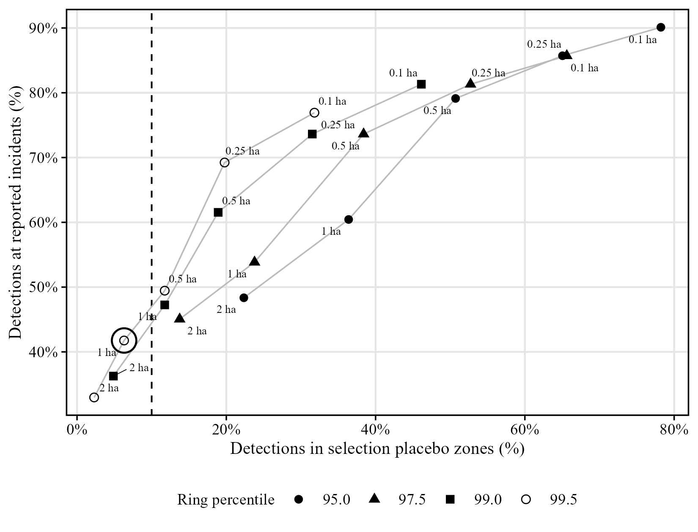
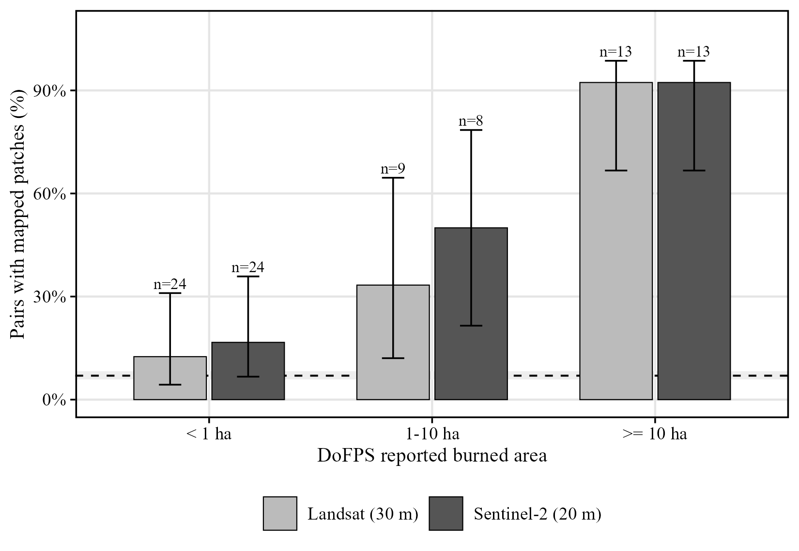
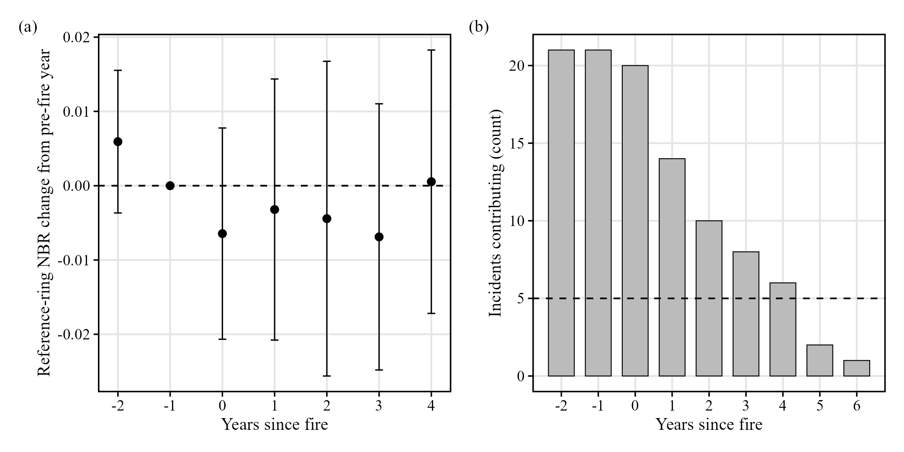

# Paro–Thimphu burn severity workshop guide

Adapted from the corresponding FIRE–BHUTAN workshop guide PDF. The theory, data notes,
analysis walk-through, exercises and glossary are presented below. The commands use RStudio.
Use the actual workshop layers supplied in the [combined participant ZIP](downloads.html).
The main practicals run from the combined RStudio project. The original analysis
examples in this reference guide use paths within the individual workshop folders.
Some maps and example output are described here and available through the participant project.

[Workshop practical scripts](burn.html#practicals) · [RStudio setup](setup.html)

## Contents

- [Part 1. Background and theory](#part-1)
- [Part 2. How satellites see fire](#part-2)
- [Part 3. Detection and statistics in simple language](#part-3)
- [Part 4. The data in detail](#part-4)
- [Part 5. Setting up and reading the code](#part-5)
- [Part 6. The analysis step by step](#part-6)
- [Part 7. Exercises](#part-7)
- [Part 8. Limitations, next steps and troubleshooting](#part-8)
- [Glossary](#glossary)
- [Key references (verified against Crossref)](#references)

### Suggested two-day programme

| Day | Session | Content | Time |
|---|---|---|---|
| 1 | 1 | Part 1: fire, burn severity and the study questions | 45 min |
| 1 | 2 | Part 2: how satellites see fire (reflectance, NBR, dNBR, RBR, masks, composites) | 90 min |
| 1 | 3 | Part 3: detection and statistics (patches, placebo zones, thermal evidence, intervals, models) | 75 min |
| 1 | 4 | Part 4: the data; Part 5: setting up RStudio and R, reading R code | 90 min |
| 2 | 5 | Step 02 on one fire: lessons 2.1–2.6; start the full step 02 run (13 min) | 75 min |
| 2 | 6 | Step 02 code walk-through; lessons 3.1–3.4; read `01-severity` | 90 min |
| 2 | 7 | Step 03 trajectories: lessons 4.1–4.2, run, read `02-recovery` | 45 min |
| 2 | 8 | Step 04 field design: lessons 5.1–5.2, run, read `03-cbi-plan` | 45 min |
| 2 | 9 | Part 7 exercises, Part 8 limitations, discussion | 60 min |

For a one-day workshop, start the full run (about 14 minutes) at the beginning, teach Parts 1–3 while it runs, then go through the lessons and the finished folders.

## Part 1. Background and theory

### 1.1 Forest fires in Paro and Thimphu

Most forest fires in Paro and Thimphu are small surface fires in the dry season, roughly November to May. They are mostly started by people. They burn through blue pine, chir pine, broadleaf and mixed conifer forest, and through the open grass and scrub slopes between them.

The Department of Forests and Park Services (DoFPS) records each fire with a date, a location, an estimated area and, where known, a cause. Nobody had yet tested how well free satellite images can confirm and map these fires, or how strongly the burned land changed.

### 1.2 Fire intensity, fire severity and burn severity

Three terms are often mixed up:

| Term | Meaning | How it is measured |
|---|---|---|
| **Fire intensity** | how much energy the fire releases while burning | flame length, heat (for example the fire radiative power seen by thermal satellites) |
| **Fire severity** | how much the fire changed the vegetation and soil right after burning | field scores such as the **Composite Burn Index (CBI)**, satellite change indices |
| **Burn severity** | fire severity plus the first response afterwards (tree death, resprouting) | the same, usually measured about a year after the fire |

Satellites measure **spectral change**: how much the light reflected from the land changed. Spectral change becomes "severity" only after it is matched to field measurements such as CBI plots. This package has not done that yet, so it calls its classes **spectral-change classes**, not severity classes.

### 1.3 The three questions, in order of the evidence available

1. **Detection.** Can 20–30 m satellite images (Sentinel-2 and Landsat) detect the fires DoFPS recorded? And how do we know a detection is real and not noise?
2. **Spectral change.** For detected fires, how strongly did the vegetation signal change, and how sensitive are the maps to the analysis choices?
3. **Trajectories.** How does the satellite signal of burned areas develop in the years after the fire?

A fourth task prepares the next phase: **design the fieldwork** that will turn spectral change into measured severity and test the map's accuracy.

| Question | Script (step) | Result folder |
|---|---|---|
| Detection and spectral change | `02_severity_mapping.R` | `outputs/01-severity` |
| Trajectories | `03_post_fire_recovery.R` | `outputs/02-recovery` |
| Field design | `04_cbi_field_plan.R` | `outputs/03-cbi-plan` |

### 1.4 The main answers (you will reproduce every number)

1. **Detection works for larger fires.** Of 53 recorded fires, 46 have satellite images and 21 were mapped. 92% of fires reported at 10 ha or more were detected, but only 15% of those under 1 ha.
2. **The detection rule holds up on data it was not tuned on.**
   - In 1,766 "placebo" zones with no reported fire, it fired in 7.0% (95% interval 5.9–8.2%).
   - It detected 88% of fires that satellite thermal sensors also saw, against 23% of those they did not see.
3. **The choice of images matters.** Changing the before/after image periods changes roughly a quarter or more of the mapped patch area.
4. **Landsat and Sentinel-2 map the same fire differently.** Their median patch overlap is 77%, so both are reported.
5. **Mapped area is provisional.** About 1,135 ha of unique burned area, with a range of 851–1,485 ha depending on the analysis choices. The classes are spectral, not field-verified.
6. **Burned patches stay spectrally changed for years.** The signal drops by 0.145 NBR in the first year and is still 0.085 lower four years later.

## Part 2. How satellites see fire

### 2.1 Reflectance and spectral bands

Sunlight is a mix of wavelengths. Leaves, soil, ash and water reflect each wavelength differently. A satellite sensor measures the share of sunlight reflected in several wavelength ranges, called **bands**. Each band is a raster: a grid of **pixels**, each holding a number called **reflectance**, between 0 and 1.

Three bands matter here:

| Band | Wavelength | Healthy vegetation | Burned surface |
|---|---|---|---|
| Red | about 0.66 µm | low (chlorophyll absorbs red light) | higher |
| Near-infrared (NIR) | about 0.86 µm | **high** (leaf cell structure scatters it) | **low** |
| Shortwave infrared 2 (SWIR2) | about 2.2 µm | **low** (water in leaves absorbs it) | **high** (dry ash, char, bare soil) |

Fire **lowers NIR and raises SWIR2**. That opposite movement is what the burn indices use.

### 2.2 The two satellites

| | Landsat 8 and 9 (earlier 5 and 7) | Sentinel-2A and 2B |
|---|---|---|
| Operator | USGS and NASA | European Space Agency |
| Pixel size used here | 30 m (0.09 ha) | 20 m (0.04 ha) |
| NIR / SWIR2 bands | B5 / B7 (Landsat 5 and 7: B4 / B7) | B8A / B12 |
| Images of the same place | about every 8 days (two satellites) | about every 5 days (two satellites) |
| Archive | since 1984 (Landsat 8 since 2013) | since 2015 (both satellites since 2017) |

Each fire is analysed separately with both satellites, so most fires have two **incident–sensor pairs**.

### 2.3 Clouds and composites

In Bhutan, many images are cloudy, especially from June to September. Instead of choosing one image, the package uses a **composite**: for each pixel, the **median** of all cloud-free values in a time window. For example, a 90-day window with 18 images gives each pixel the middle value of its clear observations. The median ignores the occasional missed cloud or shadow better than the mean.

Every composite comes with the number of valid observations per pixel and, in its `.json` file, the date of every image used.

### 2.4 NBR and NDVI

**Normalized Burn Ratio:**

NBR = (NIR − SWIR2) / (NIR + SWIR2)

**Normalized Difference Vegetation Index:**

NDVI = (NIR − Red) / (NIR + Red)

Both run from −1 to +1.

Worked examples (from Lesson 2.1):

| Surface | NIR | SWIR2 | NBR |
|---|---|---|---|
| Dense forest | 0.30 | 0.08 | (0.30 − 0.08) / (0.30 + 0.08) = **0.579** |
| Grass slope | 0.22 | 0.15 | **0.189** |
| Freshly burned | 0.12 | 0.20 | **−0.250** |

Dense green forest has NBR of about 0.4–0.7, and burned ground is near 0 or negative. The composites store NBR and NDVI multiplied by 10,000 as whole numbers to save space, so 5,790 means 0.579.

### 2.5 dNBR: the change

**dNBR = NBR before − NBR after.**

A positive dNBR means the vegetation signal dropped. For the forest pixel above, if it burns to the "freshly burned" values, dNBR = 0.579 − (−0.250) = 0.829.

The classic US field guide (Key & Benson 2006) treats dNBR below about 0.100 as unburned. That 0.100 is used here as the minimum change for a burned pixel.

### 2.6 The problem of background change, and the reference ring

NBR also changes for reasons other than fire:

- season (dry grass in March, green grass in July);
- snow;
- soil moisture;
- sun angle;
- differences between images.

So even unburned land shows some dNBR.

The solution is a **reference ring**. Around each reported fire, take a ring 2–5 km away: outside the fire, but in the same landscape, season and images. The median dNBR of its usable pixels is the **background change**, or **offset**:

**dNBR_c = dNBR − median dNBR of the ring**

For the example fire, the ring's median dNBR is +0.052 (Lesson 2.3), so 0.052 is subtracted from every pixel's dNBR.

### 2.7 RBR and RdNBR: scaling the change by the vegetation present

A change of 0.20 means more in sparse grass than in dense forest, because sparse grass had less to lose. Two indices scale for this.

**Relativized Burn Ratio** (Parks et al. 2014):

RBR = 1000 × dNBR_c / (NBR before + 1.001)

**Relative dNBR** (Miller & Thode 2007):

RdNBR = 1000 × dNBR_c / √|NBR before|

The factor 1,000 puts values on the scale used in the literature. Worked example for the same change, dNBR_c = 0.20 (Lesson 2.3):

| NBR before | RBR | RdNBR |
|---|---|---|
| 0.60 (forest) | 125 | 258 |
| 0.30 | 154 | 365 |
| 0.05 (sparse grass) | 190 | **894** |

RdNBR shoots up when NBR before is near zero, because it divides by a very small number. Paro and Thimphu have many sparse grass slopes, so **RBR is the main index**.

### 2.8 Spectral-change classes

Inside detected burned patches, RBR is grouped with published thresholds (Parks et al. 2018):

| Class | RBR |
|---|---|
| Low spectral change | below 116 |
| Moderate spectral change | 116 to below 283 |
| High spectral change | 283 and above |

These thresholds were fitted to field CBI plots in North American conifer forests. Whether they suit Bhutan is unknown until local CBI plots are measured (step 04 designs them).

### 2.9 Masks: pixels that cannot be trusted

Three kinds of pixel are excluded:

1. **Not vegetated before the fire:** NDVI before below 0.2. This removes rock, buildings, roads, water and snow; you cannot burn what is not vegetation.
2. **Deep terrain shadow:** in steep mountains, slopes facing away from the sun get little direct light, and their reflectance is unreliable. The package calculates the sun's position for the middle of the after window at 10:30 local time (the satellites' overpass). With the slope and aspect from the elevation model, it gets **cos(i)**, the cosine of the angle between the sun and the slope's face: 1 = facing the sun directly, 0 = grazing light, negative = in shadow. Pixels with cos(i) below 0.15 are masked.

   Example (Lesson 2.2, sun elevation 44°, from the south-east): flat ground cos(i) = 0.70; a 35° north-facing slope 0.24; a 35° south-facing slope 0.90.
3. **Missing data:** pixels with no clear image in a window.

### 2.10 Windows: which "before" and "after"?

The choice of time window strongly affects the result (Lesson 3.4, Figure 01-7).

| Window | Dates relative to the fire | Use |
|---|---|---|
| **preM** (season-matched before) | the same 90 days, one year earlier | **main** before image |
| pre90 (adjacent before) | the 90 days just before the fire | method of version 1.0; now a sensitivity test |
| **p90** (after) | the 90 days after the fire | **main** after image |
| p30, p60 | 30 or 60 days after | shorter after windows (sensitivity) |
| ext (extended) | the same 90 days one year after | includes delayed tree death and regrowth |

**Why season-matched?** Most fires burn in winter and spring. An adjacent before image (December) compared with an after image (March) mixes fire with seasonal change: snow melt, drying grass. Comparing January–April 2025 with January–April 2024 keeps the season the same.

Only one pair, EXAMPLE_EVENT with Sentinel-2, has no usable season-matched composite. It falls back to the adjacent window and is flagged. For that fire, the Landsat pair (season-matched) is the one used in the main map.

## Part 3. Detection and statistics in simple language

### 3.1 From pixels to a detected burned patch

The detection rule has five parts (Lesson 2.4 shows each one on the example fire):

1. **Candidate pixels.** A pixel is a candidate if:
   - dNBR_c ≥ 0.100, *and*
   - its RBR is above the **99.5th percentile** of RBR in the reference ring. Only 0.5% of the ring's unburned pixels reach that value, so it is "unusually high for this landscape and season".
2. **Patches.** Candidate pixels that touch each other, including corners (**8-connectivity**), form numbered patches.
3. **Minimum size.** A patch must be at least **1 ha**: 25 Sentinel-2 pixels or 12 Landsat pixels. Smaller groups are too easily noise.
4. **Search zone.** A fire is **detected** if a large patch touches the **500 m circle** around the reported point. DoFPS coordinates are often approximate, so the patch need not cover the point itself.
5. **Hysteresis growth.** The strict threshold finds the fire's core but cuts off its lightly burned edges. The detected patch is therefore grown into connected pixels above a gentler threshold, the ring's 95th percentile.

   Example fire: 96.6 ha before growth, 153.2 ha after. The name comes from physics: a strict threshold to switch on and a looser one to stay on.

The 99.5th percentile and the 1 ha minimum were **chosen** from 20 combinations, as described next.

### 3.2 Placebo zones: how do we know detection is not noise?

A rule that "finds" a fire near every report might simply be finding noise. To test this, the same rule is applied to **placebo zones**: random 500 m circles 1.5–4.5 km from each reported fire, where no fire was reported. If the rule "detects" a fire there, that counts as **background detection**.

- There are 24 zones per incident–sensor pair: 3 distance bands × 8 zones.
- **Selection zones** (half of the farthest band) are used to **choose** the rule. The best rule is the one that finds the most reported fires while keeping background detection at or below 10%.
- **Held-out zones** (all others: 1,766 usable zones) are used only to **test** the chosen rule. This is like a school exam: you cannot grade students with the same questions you used to teach them.
- A placebo detection is not proven to be a false alarm, because some fires are never reported. That is why the package calls it a **background detection rate**, not a false-positive rate.

### 3.3 Independent thermal evidence

Two satellite fire products from completely different sensors act as an outside check:

- **FIRMS active fire.** NASA's MODIS (1 km) and VIIRS (375 m) thermal sensors detect pixels much hotter than their surroundings while a fire burns.
- **MODIS MCD64A1 burned area.** A monthly 500 m map of burned pixels.

A fire has **thermal evidence** if either product shows fire within 1 km of the reported point, from 10 days before to 30 days after the reported date. These products miss most small surface fires, so they only partly confirm the result. Still, a rule that finds 88% of thermally confirmed fires but only 23% of unconfirmed ones is clearly responding to real fire.

### 3.4 Proportions and their uncertainty: the Wilson interval

When 23 of 26 fires are detected, the rate is 88%. With only 26 fires, though, the true rate could be lower or higher. The **Wilson 95% confidence interval** (here 71–96%) gives the plausible range. It works well for small numbers and for rates near 0% or 100%.

### 3.5 Logistic regression and the odds ratio

Does detection depend on fire size? **Logistic regression** models the chance of detection (between 0 and 1) from predictors such as log10(reported area) and sensor. Its results are **odds ratios**:

- **Odds** = chance of detection ÷ chance of no detection.
- Lesson 3.2 finds an odds ratio of **9.5 per tenfold area**. A 10 ha fire has 9.5 times the odds of detection of a 1 ha fire. The sensor makes little difference (p = 0.48).

### 3.6 Comparing two maps: the Jaccard index

Jaccard = area mapped by both ÷ area mapped by either.

It is 1 for identical maps and 0 for maps with no overlap. Example fire (Lesson 3.3): Landsat 144.4 ha and Sentinel-2 153.2 ha, both 137.6 ha, either 160.1 ha, so Jaccard = 137.6 / 160.1 = 0.86. The median over all fires detected by both sensors is 0.77.

### 3.7 Repeated measurements: mixed models

In step 03, each fire is measured every year: −1 (before), 0, 1, 2 and so on. Measurements of the same fire are related, and the number of fires differs from year to year:

| Year since fire | Fires observed |
|---|---|
| 0 | 20 |
| 4 | 6 |

A simple average for year 4 would describe only the 6 fires that happen to be old enough.

A **linear mixed model** gives each fire its own starting level (a **random effect**) and estimates the average change in each year since fire (the **fixed effects**). Each fire is compared with itself. The package uses the R package `lme4` and reports **estimated marginal means** (the model's average per year, from `emmeans`).

The same idea is used for fuel and terrain models, with burned patches nested in fires.

### 3.8 Many tests: Holm and Benjamini–Hochberg

Run 20 tests at p < 0.05 and, on average, one will look "significant" by chance. Adjustments correct this:

- **Holm:** sorts p-values and multiplies the smallest by the number of tests, the next by one fewer, and so on. It is strict and used for the year-by-year tests.
- **Benjamini–Hochberg (BH):** controls the share of false discoveries. It is less strict and used for the many fuel descriptors.

Lesson 4.2 adjusts five example p-values both ways.

### 3.9 Spatial autocorrelation: Moran's I

Nearby burned patches tend to be similar. If a model's leftover errors (**residuals**) are still similar for neighbouring patches, the model's p-values are too optimistic. **Moran's I** tests this. Here p = 0.80, so there is no sign of leftover spatial pattern.

### 3.10 Field sampling: calibration and accuracy need different samples

Step 04 designs two separate samples:

- **Sample A, calibration.** CBI plots placed where the mapped class is **uniform**, so that the plot surely represents its class. They are used to fit the relationship between RBR and field CBI, which gives local class thresholds.
- **Sample B, accuracy.** Points drawn at **random** within each mapped class (a **stratified random sample**), with no uniformity filter, so that hard, mixed places are included as often as they occur. Each point has a known **inclusion probability**: its chance of being picked. With these, map accuracy and an **error-adjusted area** with confidence intervals can be estimated (Olofsson et al. 2014).

Using the uniform calibration plots to measure accuracy would make the map look better than it is, because they avoid exactly the places where maps are most often wrong.

## Part 4. The data in detail

All inputs were taken from data already in the FIRE-BHUTAN project. The only exception is the season-matched composites, which were downloaded with script 00 after checking that the project had nothing equivalent. Lesson 1.1 lists the inputs on screen.

### 4.1 DoFPS fire records

| Item | Detail |
|---|---|
| File | `data/inputs/dofps_incidents_paro_thimphu.csv` |
| Content | 100 records in Paro and Thimphu, 2017–2025: event ID, dzongkhag, gewog, village, forest type, cause, start and suppression dates, coordinates, reported area, quality flags |
| Cleaning | Coordinates were checked and fixed in the parent project (swapped latitude and longitude, degree–minute–second formats). Dates were checked. Possible duplicates were flagged. |
| Used | **53** records with valid coordinates and dates inside the study area (`in_study_area = TRUE`); reported areas 0.02–323 ha, median 0.88 ha |
| Imagery | 46 of the 53 have composites. The other 7 were left out of the image download because of quality flags. |
| Limitation | The coordinates mark where a fire was reported, not its perimeter. Areas are estimates. Small fires may be missing. |

### 4.2 Satellite composites

| Item | Detail |
|---|---|
| v1.0 adjacent windows | `data/raw/events/<event>_<sensor>_pre.tif` and `_post.tif` (+ `.json`): 90 days before and 90 days after the fire; bands `nbr_x10000`, `ndvi_x10000`, `valid_observations` |
| v1.1 season-matched | `data/raw/events_seasonal/<event>_<sensor>.tif` (+ `.json`): 12 bands, NBR, NDVI and observation count for each of the windows preM, p30, p60 and ext |
| Area | a circle of 5.5 km radius around each reported point, so the 2–5 km reference ring fits inside |
| Source | Landsat Collection 2 Level 2 and Sentinel-2 Level 2A surface reflectance, cloud-masked and composited in Google Earth Engine |
| `.json` files | window dates, number of images, the date and ID of every image used, and a checksum |
| Example | `EXAMPLE_EVENT_sentinel.tif`: 550 × 549 pixels of 20 m. The preM window (2024-01-05 to 2024-04-04) has 18 images and the ext window 24. |

### 4.3 Annual Landsat NBR (for trajectories)

`data/raw/landsat_annual_nbr/landsat_nbr_<year>.tif`, 2012–2025: the median NBR of all clear Landsat images in each calendar year, with a count of valid observations.

### 4.4 Independent evidence and land cover

| Data | File | Source |
|---|---|---|
| Active fire | `data/inputs/validation/firms_points.csv` (1,369 points) | NASA FIRMS MODIS and VIIRS, nominal or high confidence |
| Burned area | `data/inputs/validation/mcd64a1_burned_pixels.csv` (297 pixels) | MODIS MCD64A1 Collection 6.1, with burn dates |
| Annual land cover | `data/inputs/validation/dw_label_30m_<year>.tif` | Google Dynamic World annual most frequent label |
| Land cover 2021 | `data/inputs/validation/worldcover2021_30m.tif` | ESA WorldCover 2021 |

### 4.5 Terrain, forest type, access and fuel

| Data | File | Source and use |
|---|---|---|
| Elevation | `data/inputs/dem_30m.tif` | Copernicus GLO-30 elevation model: slope, aspect and the shadow mask |
| Forest type | `data/inputs/forest_type_50m.tif` | DoFPS forest-type map: forest type of burned pixels |
| Walking time | `data/inputs/walk_time_to_road_h_100m.tif` | parent project model: field plot accessibility |
| Study area | `data/inputs/study_area.gpkg` | dzongkhags, gewogs, 5 km context buffer |
| Fuel descriptors | `data/inputs/RESTRICTED/...` (historical folder name) | derived from National Forest Inventory 2022 plots; included in the package by DoFPS. Used for the exploratory fuel models; if the file is missing, only those models are skipped. |

Every raster is in **EPSG:5266 (DRUKREF 03 / Bhutan National Grid)**, in metres. Latitudes and longitudes in CSV files are WGS84.

### 4.6 The settings file `config/settings.json`

Every analysis choice is in one text file. Open it with `notepad config\settings.json`. The `severity` section holds:

| Setting | Value | Meaning |
|---|---|---|
| `reference_ring_m` | [2000, 5000] | reference ring 2–5 km from the reported point |
| `search_radius_m` | 500 | search zone radius |
| `noise_quantile_grid` | 0.95, 0.975, 0.99, 0.995 | candidate ring percentiles tried |
| `min_patch_ha_grid` | 0.1, 0.25, 0.5, 1, 2 | candidate minimum patch sizes tried |
| `max_placebo_rate` | 0.10 | maximum background detection allowed when choosing the rule |
| `grow_quantile` | 0.95 | gentler threshold for hysteresis growth |
| `min_pre_ndvi_vegetated` | 0.2 | vegetation mask |
| `unburned_low_dnbr_x1000` | 100 | minimum dNBR_c × 1000 for a burned pixel |
| `rbr_low_moderate`, `rbr_moderate_high` | 116, 283 | class thresholds |
| `min_cos_illumination`, `overpass_local_time_h` | 0.15, 10.5 | shadow mask |
| `windows` | main [preM, p90]; fallback [pre90, p90]; five sensitivity configurations | time windows |
| `placebo` | 3 bands (1.5–2.5, 2.5–3.5, 3.5–4.5 km), 8 zones each, selection = band 3 zones 1–4 | placebo design |
| `search_radius_test_m` | 100, 250, 500, 1000 | radius sensitivity |
| `thermal` | 1,000 m, 10 days before, 30 days after | thermal evidence window |

The `recovery` section sets the trajectory years. The `field_plan` section sets the field design: 20 plots per class plus 25% reserve, walk ≤ 2 h, slope ≤ 40°, spacing ≥ 90 m, priority year 2025, field season start 15 January 2027, 50 accuracy points per class.

## Part 5. Setting up and reading the code

### 5.1 Prepare the workshop project

1. Download the real-data project ZIP from the organizer's Google Drive link and extract the whole archive.
2. Open `Bhutan_Forest_Fire_Workshops.Rproj` in RStudio. Run `01_Install_Workshop_Packages.R` once before going offline.
3. Open `r_studio_run/` in RStudio. Select a section and press **Ctrl+Enter** or click **Source** to execute the complete file.

### 5.2 Inspect outputs and run the stages

Open the practical named for the output folder you need. Its default is to work directly
with the reviewed real-data outputs in the ZIP. In a separate working copy, change
`rebuild <- FALSE` to `TRUE` in Block 10 to regenerate the result.

The commands below also work when an instructor opens the individual workshop project.

```r
source("START_HERE.R")
check_project("02")
## Run only after preflight reports PASS.
run_project("02")
```

Long stages print a log path under `logs/`. The lessons are available while you wait.
Each workbook in `process_data/` provides the values behind its figure.

### 5.3 Read the R code

Use `str()` to inspect columns, `head()` for a preview and `summary()` to check ranges
before calculating. `terra` reads raster grids and `sf` reads spatial features.
The project's shared files open the input paths relative to the project folder.
Keep returned field forms in a separate folder before replaying a field-design stage.

### 5.4 Reading R code in ten minutes

| R code | Meaning |
|---|---|
| `x <- 5` | store 5 in `x` |
| `c(2000, 5000)` | a list of values (a vector) |
| `x[3]`, `x[x > 0]` | the 3rd value; the values greater than 0 |
| `a & b`, `a \| b`, `!a` | and, or, not |
| `a %in% c(1, 2)` | TRUE where `a` is 1 or 2 |
| `median()`, `quantile(x, 0.995)` | the middle value; the value below which 99.5% of values lie |
| `ifelse(test, yes, no)` | choose a value pixel by pixel |
| `function(x) { ... }` | a reusable recipe |
| `for (k in 1:91) { ... }` | repeat for each incident–sensor pair |
| `lapply`, `do.call(rbind, ...)` | apply a recipe to many items; stack the results into one table |
| `CFG$severity$search_radius_m` | a value from the settings file |
| `# text` | a comment for people, ignored by R |

GIS functions used (packages `terra` and `sf`):

| Function | What it does |
|---|---|
| `rast(file)`, `values(r)` | open a raster; get its pixel values as a long list |
| `distance(r, point)` | distance from every pixel to a point |
| `terrain(dem, "slope")` | slope or aspect from an elevation model |
| `patches(r, directions = 8)` | join touching pixels into numbered patches |
| `resample(r, template)` | move a raster onto another grid |
| `extract(r, xy)` | read raster values at points |
| `as.polygons(r)` | turn raster patches into polygons |
| `st_read`, `st_write` | read or write a vector layer (GeoPackage) |
| `writeRaster(r, file)` | save a GeoTIFF |

### 5.5 The shared helper file `R/tp_common.R`

Every script starts by loading this file. Its key parts:

```r
TP <- local({
  if (file.exists("config/settings.json") && file.exists("R/tp_common.R")) "."
  else if (file.exists("thimphu_paro_burn_severity/config/settings.json")) "thimphu_paro_burn_severity"
  else stop("Run from the parent project root or from inside thimphu_paro_burn_severity/.")
})
CFG <- read_json(tp("config/settings.json"), simplifyVector = TRUE)
```

This finds the package folder wherever it was unzipped and reads the settings once. `tp("data/inputs")` builds paths inside the package. `Sys.setenv(TZ = "Asia/Thimphu")` makes all dates Bhutan time.

```r
idx_rbr   <- function(dnbr_c, pre) 1000 * dnbr_c / (pre + 1.001)
idx_rdnbr <- function(dnbr_c, pre) { r <- 1000 * dnbr_c / sqrt(abs(pre)); r[abs(pre) < 1e-3] <- NA; r }
```

These are the two indices from Part 2.7. RdNBR is set to empty where NBR before is practically zero, to avoid dividing by zero.

```r
SEV_LEVELS <- c("No detected change", "Low spectral change", "Moderate spectral change", "High spectral change")
```

These are the class names (codes 0–3) used in every map and table.

```r
sun_position <- function(date, hour, lon, lat, tz = 6) { ... }
cos_incidence <- function(slope, aspect, sun) {
  z <- (90 - sun[["elevation"]]) * pi / 180; a <- sun[["azimuth"]] * pi / 180
  cos(z) * cos(slope) + sin(z) * sin(slope) * cos(a - aspect) }
```

`sun_position` uses the standard NOAA astronomical formulas to give the sun's elevation and direction for a date, time and place. `cos_incidence` combines the sun with each pixel's slope and aspect to give cos(i) for the shadow mask (Part 2.9).

`wilson_ci()` is the Wilson interval (Part 3.4). `aspect_class()` turns aspect degrees into N, NE, E and so on.

### 5.6 The figure and table helpers `R/sci_figure.R`

| Function | What it produces |
|---|---|
| `sci_run(slug, title)` | sets up the output folder, for example `outputs/01-severity` |
| `save_fig(run, plot, n, name, data, caption)` | saves figure n as PNG, JPG and PDF, saves its data as `process_data/fig_0n_data.xlsx`, and adds its caption to `captions.md` |
| `write_process(run, table, name)` | saves an intermediate table as `process_data/NN_name.xlsx` |
| `data_health(run, table, name)`, `write_health(run, notes)` | data checks and notes in `00_data_health.md` |
| `build_report(run)` | the combined `report.pdf` |

### 5.7 Check your laptop

Source `START_HERE.R` and call `check_project()` in the RStudio Console. Resolve missing packages or files before rebuilding.

## Part 6. The analysis step by step

The package already contains the results of all steps, so the lessons work before anything is run. Steps must run in order (02 → 03 → 04), because each uses the previous step's files.

### 6.1 Step 02 on one fire: lessons 2.1–2.6

These lessons repeat, for the example fire, exactly what step 02 does for each of the 91 incident–sensor pairs. The lesson file `scripts/workshop_lessons.R` contains a compact copy of the step 02 functions (`example()`, `patches_of()`, `detect()`), and its numbers match step 02 exactly.

#### Lesson 2.1: the before and after images

```r
source("r_studio_run/lesson-2-1.R")
```

```r
tmpl <- rast(file.path(EV, paste0(KEY, "_pre.tif")))[[1]]          # the master 20 m grid of this pair
pre  <- read_window("preM", tmpl); post <- read_window("p90", tmpl)  # season-matched before, 90-day after
g <- pre$nbr; dist <- distance(g, pt)                                # NBR before; distance of every pixel from the report
```

`read_window()` opens the composite file, names its 12 bands (for example `nbr_preM`), divides by 10,000, and returns NBR, NDVI, the observation count and the window dates. `distance()` makes a raster of the distance of every pixel from the reported point; it is used later for the 500 m zone and the 2–5 km ring.

Expected output:

```
Example fire: see the participant project's example configuration and Console output.
Before (preM): 2024-01-05 to 2024-04-04, 18 images | After (p90): 2025-01-08 to 2025-04-08, 20 images
Grid: 551 x 551 pixels of 20 m (0.04 ha each)
Median NBR within 500 m of the report: before 0.467, after 0.335
Median NBR in the 2-5 km ring:         before 0.215, after 0.019
```

> **Participant figure.** Lesson 2.1: NBR before (left), after (middle) and dNBR (right) around the example fire; the cross is the reported point. White = no clear observation. See `logs/lesson_2.1_before_after.png` in the workshop working copy after the corresponding stage or lesson.

**Discuss.**

- **The burn scar.** It is the dark area east of the cross in the middle panel, and the bright area in the dNBR panel. The reported point is at the edge of the burn, not its centre.
- **The ring changed too.** Its median NBR fell from 0.215 to 0.019 without fire, because the ring medians here include snow, rock and high pasture. The masks (Lesson 2.2) and the offset (Lesson 2.3) deal with that.
- **Other bright patches** in the dNBR panel are changes not linked to this report. The 500 m search zone keeps the detection from picking them up.

#### Lesson 2.2: masks

```r
source("r_studio_run/lesson-2-2.R")
```

```r
w <- as.Date(c(post$start, post$end)); mid <- w[1] + as.integer(diff(w) / 2)           # middle of the after window
sun <- sun_position(mid, SV$overpass_local_time_h, ev$longitude, ev$latitude)          # sun at 10:30
cosi <- cos_incidence(slope, aspect, sun)                                              # light on each slope
V$veg <- V$ndvi >= SV$min_pre_ndvi_vegetated; V$lit <- V$cosi >= SV$min_cos_illumination
usable <- is.finite(V$dnbr) & is.finite(V$pre) & V$veg %in% TRUE & V$lit %in% TRUE
```

The last line is the full mask: a pixel is **usable** only if it has data, was vegetated before, and is lit.

Expected output:

```
Sun at the middle of the post-fire window, 10:30 local time: elevation 44.1 deg, azimuth 143 deg
Whole image:  not vegetated before (NDVI < 0.2) 41% | deep shadow (cos i < 0.15) 5% | usable 57%
Within 500 m: not vegetated 10% | deep shadow 4% | usable 87%
  flat                   cos(i) = 0.70
  35 deg, facing north   cos(i) = 0.24
  35 deg, facing south   cos(i) = 0.90
```

**Discuss.** 41% of the 5.5 km circle is not vegetated: high rock, snow and alpine land. Near the fire, 87% of pixels are usable. In winter the sun is low (44°), so steep north-facing slopes get little light. Picture: `logs\lesson_2.2_masks.png`.

#### Lesson 2.3: the offset, dNBR_c, RBR and RdNBR

```r
source("r_studio_run/lesson-2-3.R")
```

```r
ring <- usable & V$dist >= SV$reference_ring_m[1] & V$dist <= SV$reference_ring_m[2]   # usable pixels 2-5 km away
off <- median(V$dnbr[ring])                                                             # background change
V$dnbr_c <- V$dnbr - off; V$rbr <- idx_rbr(V$dnbr_c, V$pre); V$rdnbr <- idx_rdnbr(V$dnbr_c, V$pre)
```

Expected output:

```
Usable ring pixels (2-5 km): 122,313
Ring dNBR: median 0.052 (this is the offset), IQR 0.067
Inside 500 m: median dNBR 0.100 -> dNBR_c 0.048 | median RBR 34 | median RdNBR 83
```

It then repeats the RBR / RdNBR worked example from Part 2.7.

**Discuss.** Once the masks are applied, the vegetated ring changed by +0.052 between the two years without fire. The median inside 500 m is low because the zone covers much unburned land; the burn sits at one side.

#### Lesson 2.4: detecting the burned patch

```r
source("r_studio_run/lesson-2-4.R")
```

The detection code (as in step 02, function `apply_rule`):

```r
thr  <- unname(quantile(P$V$rbr[P$ring], q))                                     # 1. ring percentile threshold
cand <- P$usable & P$V$dnbr_c >= 0.100 & P$V$rbr >= thr                           # 1. candidate pixels
pv   <- values(patches(setValues(P$g, ifelse(cand, 1, NA)), directions = 8))       # 2. numbered patches
big  <- as.integer(names(which(table(pv) >= ceiling(min_ha / P$px_ha))))          # 3. large enough
keep <- intersect(unique(pv[P$V$dist <= 500 & !is.na(pv)]), big)                  # 4. touching the 500 m zone
## 5. growth: recompute patches with the gentler 95th-percentile threshold, keep those containing the seed
```

`table(pv)` counts pixels per patch. `ceiling(1 / 0.04)` = 25 pixels for 1 ha at 20 m.

Expected output:

```
Rule chosen in step 02: ring percentile 99.5, minimum patch 1.00 ha
1. Threshold = 99.5 percentile of ring RBR = 383
2. Candidate pixels (dNBR_c >= 0.100 and RBR >= 383): 3,103
3. Patches (8-connected groups): 56; of these >= 1.00 ha (25 pixels): 4
4. Large patches touching the 500 m search zone: 1 -> 96.6 ha
5. After growth into connected pixels above the ring 95th percentile (RBR 110): 153.2 ha
6. Spectral-change classes (ha): Low 1.4, Moderate 34.4, High 117.4
   Reported area: 240.6 ha (step 02 mapped 153.24 ha for this pair)
```

> **Participant figure.** Lesson 2.4: candidate pixels (left), the detected patch before growth (middle) and the final classes after growth (right). See `logs/lesson_2.4_detection.png` in the workshop working copy after the corresponding stage or lesson.

**Discuss.**

- **The rule filters out noise in stages.** Of 56 patches, only 4 are large enough, and only 1 touches the search zone.
- **Growth adds the edges.** It adds 57 ha of lighter-burned margin.
- **Mapped area is less than reported:** 153 ha against 240.6 ha reported. Possible reasons: the reported area may include unburned islands or be an estimate; parts may be masked; or the satellite misses lightly burned understorey.

#### Lesson 2.5: placebo zones around the example fire

```r
source("r_studio_run/lesson-2-5.R")
```

The lesson draws 24 random 500 m zones in the three distance bands around the example fire and applies the same rule. A zone counts as unusable if it falls off the image, overlaps the detected fire, or is less than half usable. Typically one or two zones "detect" something: a small disturbance or an unreported fire. Step 02 does this for every pair, and the overall held-out rate is 7.0%.

#### Lesson 2.6: thermal evidence for the example fire

```r
source("r_studio_run/lesson-2-6.R")
```

Expected: **14 FIRMS detections** (MODIS and VIIRS, 4–5 January 2025) within 1 km of the report. No MCD64A1 pixels, because the 500 m product misses small or quick fires. The example fire is therefore thermally confirmed.

### 6.2 Run step 02 (all fires)

```r
source("START_HERE.R")
check_project("02")
## Proceed after preflight reports PASS.
run_project("02")
```

This took **12.9 minutes** on the development laptop (16 GB RAM). On screen you will see:

```
Rule (selection zones): q 0.995, min 1.00 ha -> detection 42%, selection-zone rate 6.3%, held-out rate 7.0%
EXAMPLE_EVENT_landsat    season-matched offset +0.021  patches  0  mapped   0.00 ha (reported 1.2)
...
EXAMPLE_EVENT_sentinel    season-matched offset +0.052  patches  1  mapped 153.24 ha (reported 240.62)
...
window sensitivity: v1.0 (adjacent 90 d)
...
```

There is one line per incident–sensor pair, then one line per window configuration. For a shorter session, use the reviewed starter outputs and work through the real-data practical without rebuilding.

### 6.3 Code walk-through: `scripts/02_severity_mapping.R`

The script has about 560 lines in nine blocks. Open it with `notepad scripts\02_severity_mapping.R`.

**Block 0: settings and inputs (lines 19–53).**

- Reads the `severity` settings (`SV`), windows (`WIN`), placebo design (`PL`) and thermal settings (`TH`).
- Lists the 91 incident–sensor pairs that have both image files.
- Reads the elevation model, forest type, incident points (converted to EPSG:5266) and the thermal points.
- `TP_MAX_PAIRS` is the quick-mode switch.
- Temporary raster files go to `_tmp_terra` inside the package and are deleted at the end.

**Block 1: reading windows, `layer()` (lines 56–74).** Reads one window of one pair: from the v1.0 files (`pre90`, `p90`) or from the 12-band seasonal file (`preM`, `p30`, `p60`, `ext`). Every window is put on the same master grid, the v1.0 pre-fire grid. If a window has no clear image, it returns nothing and the pair falls back to the adjacent window.

**Block 2: preparing one pair, `prep()` (lines 77–105).** Everything from Lessons 2.1–2.3:

1. NBR before and after;
2. distance to the report;
3. slope, aspect and the sun, giving cos(i);
4. the masks (`usable`);
5. the ring and its offset (`off`), then dNBR_c, RBR and RdNBR.

It also places the 24 placebo zones. `set.seed(1000 + k)` gives each pair the same zones in every configuration.

`ok` requires at least 50 usable ring pixels and 5 valid pixels near the report; otherwise the pair is "insufficient".

**Block 3: the detection rule, `lab_patches()`, `candidates()`, `apply_rule()` (lines 106–123).** The code from Lesson 2.4. `apply_rule()` also tests every placebo zone: a zone "detects" if a large candidate patch lies inside it. Zones overlapping the real fire, falling off the image or mostly unusable are left out (`NA`).

**Block 4: choosing the rule on the selection zones (lines 131–147).**

```r
GRID <- expand.grid(q = SV$noise_quantile_grid, min_ha = SV$min_patch_ha_grid)     # 4 x 5 = 20 rules
... for each pair, for each rule: detected? hits in selection zones? hits in held-out zones?
CAL$eligible <- CAL$placebo_selection <= SV$max_placebo_rate                         # <= 10% background
best <- CAL[CAL$eligible, ][order(-detection, min_ha, q), ][1, ]                     # most detection among eligible
```

The held-out rate is computed here but **not** used for the choice. Lesson 3.1 prints the whole table.

**Block 5: mapping every pair (lines 150–212).** For each pair:

1. **Detect and classify.** Applies the chosen rule with growth, and classifies RBR into the three classes with `cut()`.
2. **Thermal evidence.** Checks thermal evidence at the report and inside the patches.
3. **Possible contamination.** Counts later fires within 5.5 km inside the after window.
4. **Metrics.** Writes a row of metrics: windows, image counts, offset, threshold, masked shares, detection, area by class, reported area.
5. **Radius sensitivity.** Repeats detection at 100, 250, 500 and 1,000 m.
6. **Patches.** Turns patches into polygons with their mean RBR, dominant class, terrain and forest type.
7. **Saves the map:** `data/derived/severity_rasters/<event>_<sensor>_severity.tif`.

**Block 6: window sensitivity (lines 215–230).** Reruns the whole procedure with the same rule for the five window configurations. It compares each one with the main map using the Jaccard index and class agreement.

**Block 7: choosing one map per fire, and the atlas (lines 233–280).**

```r
choose <- ... d[order(d$window_config != "season-matched", d$sensor != "sentinel"), ] ...   # season-matched first, then Sentinel-2
```

For each fire, the season-matched pair comes first, then Sentinel-2 (finer pixels), and detected pairs are preferred. The **atlas** combines the chosen maps on one 20 m grid:

- the highest class where fires overlap;
- how many times each pixel was mapped (repeat burns);
- the first and latest fire year.

Sensor-only atlases are also built, and the Landsat–Sentinel-2 overlap is calculated.

**Block 8: area range, evaluation, land cover and models (lines 283–345).**

- **Area range:** totals under every alternative (sensor, eligible rules, radius, windows).
- **Evaluation tables:** placebo rates by band with Wilson intervals; detection with and without thermal evidence.
- **Non Forest pixels:** for burned pixels the forest-type map calls Non Forest, their Dynamic World land cover the year before and their WorldCover class.
- **Mixed models:** fuel (using the NFI fuel layer) and terrain; Moran's I on the residuals. `safe()` skips a model with a message if it cannot be fitted, for example in quick mode.

**Block 9: outputs (lines 348 to end).**

- **GeoPackage:** `burn_severity_paro_thimphu.gpkg`, with selected patches, patches from all sensors, incident points and placebo zones.
- **CSV tables:** incident–sensor metrics, the incident summary, window and radius sensitivity.
- **Output folder:** data health notes, 11 figures and 15 process tables.
- **Results summary:** `results_severity.json`.

### 6.4 Lessons 3.1–3.4: results across all fires

#### Lesson 3.1: choosing the rule

```r
source("r_studio_run/lesson-3-1.R")
```

Expected (first rows, percentages):

```
     q min_ha detection placebo_selection placebo_heldout eligible
 0.995   1.00      41.8               6.3             7.0     TRUE
 0.990   2.00      36.3               4.9             7.8     TRUE
 0.995   2.00      33.0               2.3             4.2     TRUE
 0.950   0.10      90.1              78.2            76.1    FALSE
 ...
```

**Discuss.**

- **The loosest rule** (95th percentile, 0.1 ha) "detects" 90% of reported fires, but also fires in 78% of empty zones: it is mostly noise.
- **Only 3 of the 20 rules** stay at or below 10% background detection.
- **The chosen rule held up.** Its held-out rate (7.0%) is close to its selection rate (6.3%), so it was not over-tuned to the selection zones.

#### Lesson 3.2: detection by size, thermal evidence and sensor

```r
source("r_studio_run/lesson-3-2.R")
```

Expected (key lines):

```
   < 1 ha    48        7       15      7      27
  1-10 ha    17        7       41     22      64
 >= 10 ha    26       24       92     76      98
 FALSE       65       15       23     15      35     (no thermal evidence)
  TRUE       26       23       88     71      96     (thermal evidence)
Odds ratio for log10(area): each tenfold larger fire multiplies the odds of detection by 9.5
```

**Discuss.** Most DoFPS records are small (median 0.88 ha), and 20–30 m images cannot reliably see a fire of a fraction of a hectare under a canopy. That explains why only 42% of all pairs are detected.

#### Lesson 3.3: Landsat versus Sentinel-2

```r
source("r_studio_run/lesson-3-3.R")
```

```r
i <- st_area(st_intersection(a, b)); u <- st_area(st_union(a, b)); jaccard <- i / u
```

Expected: the example fire has a Jaccard of 0.86. Across fires, the sensors agree on detected or not for 91% of the 45 fires imaged by both, and the median Jaccard among fires detected by both is 0.77.

#### Lesson 3.4: how much does area depend on choices?

```r
source("r_studio_run/lesson-3-4.R")
```

Expected (rounded hectares):

```
 Main analysis (sum of selected incident maps)   1176
            Landsat only (46 incidents imaged)   1046
         Sentinel-2 only (45 incidents imaged)   1111
                           Search radius 100 m    851
                          Search radius 1000 m   1485
                 Windows: v1.0 (adjacent 90 d)   1079
        Windows: extended (+1 yr, same season)   1219
Atlas (unique) area 1135 ha: low 117, moderate 502, high 516, burned more than once 40 | range across choices 851-1485 ha
```

**Discuss.**

- **Why the main total exceeds the atlas:** the main total (1,176 ha) is a sum of fire maps, so overlapping fires count twice. The atlas (1,135 ha) counts each pixel once; 40 ha burned more than once.
- **Which choice matters most:** the search radius changes the total most, so report the radius with any area figure.

### 6.5 Reading `outputs/01-severity`

| File | Content |
|---|---|
| `process_data/01_rule_selection_and_heldout.xlsx` | the 20 rules with selection and held-out rates |
| `process_data/02_placebo_by_band_and_set.xlsx` | background detection by distance band, with Wilson intervals |
| `process_data/03_thermal_evaluation.xlsx` | detection with and without thermal evidence |
| `process_data/04_composites_masks_by_incident.xlsx` | windows, image dates, offsets and masked shares per pair |
| `process_data/05_incident_summary.xlsx` | every incident and its result |
| `process_data/06_burned_patches_selected.xlsx` | every mapped patch |
| `process_data/07_sensor_comparison.xlsx`, `08_sensor_specific_atlas_totals.xlsx` | Landsat vs Sentinel-2 |
| `process_data/09_atlas_by_dzongkhag.xlsx` | burned area by dzongkhag and class |
| `process_data/10_provisional_area_range.xlsx` | totals under each analysis choice |
| `process_data/11_window_sensitivity.xlsx` | the five window configurations |
| `process_data/12_nonforest_composition.xlsx` | land cover of Non Forest burned pixels |
| `process_data/13_fuel_mixed_models.xlsx`, `14_terrain_mixed_model.xlsx` | the models |
| `process_data/15_parameters.xlsx` | every parameter used |
| `data/derived/burn_severity_paro_thimphu.gpkg` | patches, incident points and placebo zones (open in QGIS) |
| `data/derived/severity_rasters/` | one class map per incident–sensor pair |
| `data/derived/atlas_*.tif` | highest class, times mapped, first and latest fire year (20 m) |

> **Participant figure.** Figure 01-1. DoFPS incidents by satellite result: filled = mapped, open = imaged but not detected, cross = no imagery; size = reported area. See `outputs/01-severity/figures/png/fig_01_incident_overview.png` in the workshop working copy after the corresponding stage or lesson.

**How to read it.** 21 of 46 imaged incidents were mapped, mostly the large symbols. Satellite detection covers part of the reported fire activity and does not replace field perimeters.

> **Participant figure.** Figure 01-2. Provisional spectral-change classes of the six largest mapped fires; the cross is the reported point. See `outputs/01-severity/figures/png/fig_02_change_maps_top6.png` in the workshop working copy after the corresponding stage or lesson.

**How to read it.**

- **Shapes:** the patches follow slopes and ridges.
- **Where the burn sits:** reported points often lie at the edge of the burn.
- **The high class:** it covers much of these patches. Whether that means high *ecological* severity can only be tested with the CBI plots.



*Figure 01-3. Choosing the detection rule on the selection placebo zones. Each point is one rule; the dashed line is the 10% ceiling; the circled rule is used throughout.*

**How to read it.** Moving right means more background detection; moving up means more reported fires found. The best rule is the highest point left of the dashed line.

> **Participant figure.** Figure 01-4. Independent evaluation: (a) background detection in held-out zones by distance band; (b) detection with and without thermal evidence. See `outputs/01-severity/figures/png/fig_04_independent_evaluation.png` in the workshop working copy after the corresponding stage or lesson.

**How to read it.**

- **Panel (a):** about 6–8% in every band (703, 711 and 352 zones), and the crosses show the rate excluding zones with thermal evidence. The rate does not change with distance, which suggests a uniform background rather than spill-over from the reported fires.
- **Panel (b):** 88% against 23%.



*Figure 01-5. Detection by reported area and sensor (Wilson 95% intervals); dashed line = held-out background rate.*

**How to read it.** Detection rises from 15% (< 1 ha) to 92% (≥ 10 ha), with an odds ratio of 9.5 per tenfold area. The two sensors behave similarly. Small-fire detection (15%) is close to the background rate (7%), so a single small "detection" should be treated with care.

> **Participant figure.** Figure 01-6. Search-radius sensitivity: (a) detection and (b) mapped area. See `outputs/01-severity/figures/png/fig_06_search_radius_sensitivity.png` in the workshop working copy after the corresponding stage or lesson.

**How to read it.** From 100 m to 1,000 m, detection rises from 33% to 47% and area from 851 to 1,485 ha. A larger radius accepts more real fires with poor coordinates, but also more unrelated patches. 500 m is a compromise.

> **Participant figure.** Figure 01-7. Window sensitivity: (a) detection; (b) Jaccard overlap with the main map (bars) and class agreement (crosses). See `outputs/01-severity/figures/png/fig_07_window_sensitivity.png` in the workshop working copy after the corresponding stage or lesson.

**How to read it.**

| Window configuration | Overlap with the main map (Jaccard) |
|---|---|
| v1.0 adjacent windows | 0.73 |
| Season-matched, 30-day after | 0.72 |
| Season-matched, 60-day after | 0.73 |
| Extended (one year later) | 0.44 |

A map is meaningful only together with its windows.

> **Participant figure.** Figure 01-8. Mapped against reported area (a) and Landsat against Sentinel-2 (b), log scales. See `outputs/01-severity/figures/png/fig_08_area_agreement.png` in the workshop working copy after the corresponding stage or lesson.

**How to read it.**

- **Panel (a):** mapped area ranks fires like reported area (Spearman 0.78), with a median ratio of 1.07.
- **Panel (b):** for the 17 fires detected by both sensors, the median overlap is 0.77, so sensor-specific totals are reported.

> **Participant figure.** Figure 01-9. Land cover before the fire of burned pixels the forest-type map labels Non Forest. See `outputs/01-severity/figures/png/fig_09_nonforest_composition.png` in the workshop working copy after the corresponding stage or lesson.

**How to read it.** Half of all burned pixels lie in the forest-type map's "Non Forest" class. Before the fires, these were 67% grass or shrub, 28% trees (that the forest-type map does not show) and 4% crops, built or bare (Dynamic World). Many "non-forest" fires are therefore grass and scrub fires, part of the forest-fire landscape.

> **Participant figure.** Figure 01-10. RBR and RdNBR of burned pixels across pre-fire NBR, each divided by its moderate/high threshold. See `outputs/01-severity/figures/png/fig_10_rbr_vs_rdnbr.png` in the workshop working copy after the corresponding stage or lesson.

**How to read it.** Where NBR before is below 0.1, RdNBR spreads 3.5 times as widely as RBR. This is the instability from Part 2.7, seen in the real data.

> **Participant figure.** Figure 01-11. Exploratory fuel associations (NFI fuel layer, 2021–2022). See `outputs/01-severity/figures/png/fig_11_fuel_models.png` in the workshop working copy after the corresponding stage or lesson.

**How to read it.** In 20 patches from 18 fires, no fuel descriptor has a clear effect. Shrub cover has a standardised effect of 0.25, 95% interval −0.12 to 0.62. The fuel maps (2021–2022) postdate some fires, so this is exploratory. The NFI fuel layer is included in the package, so this figure is regenerated on workshop laptops too.

**Check questions for step 02.**

1. Why is the reference ring needed?
2. Why are the rule-choosing zones and the testing zones kept separate?
3. Why should a detection of a 0.3 ha fire be treated with care?
4. What two analysis choices change the mapped area most?

### 6.6 Step 03: post-fire spectral trajectories

**Aim.** Follow the satellite signal of each mapped fire, year by year, relative to its surroundings.

**Inputs.**

- burned patches from step 02;
- annual Landsat NBR, 2012–2025.

**Outputs.**

- `outputs/02-recovery/`;
- `data/derived/results_recovery.json`;
- `incident_spectral_trajectory_summary.csv`.

#### Lesson 4.1: a trajectory by hand

```r
source("r_studio_run/lesson-4-1.R")
```

The lesson follows fire EXAMPLE_EVENT (December 2021, 217 ha), which has four years of follow-up:

**rel(t) = [NBR patch(t) − NBR ring(t)] − [NBR patch(before) − NBR ring(before)]**

```
 year  t patch_nbr ring_nbr   diff    rel
 2021 -1     0.139    0.505 -0.366  0.000
 2022  0     0.002    0.502 -0.500 -0.134
 2023  1     0.000    0.483 -0.483 -0.117
 2024  2     0.026    0.447 -0.421 -0.055
 2025  3     0.083    0.456 -0.373 -0.007
```

**Discuss.**

- **What the numbers mean:**
  - **The starting gap:** the patch was already darker than its ring before the fire (about −0.37). It is a sparse, grassy slope.
  - **The fire's effect:** the fire pushed it a further 0.134 down in year 0.
  - **The return:** by 2025 it is almost back to the pre-fire difference.
- **Why "year 0" is 2022:** a December fire falls mostly in the following year's composite.
- **What NBR cannot tell us:** whether trees died, grass regrew or soil is exposed. These are spectral trajectories, not forest recovery.

#### Lesson 4.2: why a mixed model?

```r
source("r_studio_run/lesson-4-2.R")
```

Expected:

```
-1  0  1  2  3  4
21 20 14 10  8  6        (fires observed in each year since fire)
  t simple_mean model_mean
  0      -0.146     -0.146
  4      -0.095     -0.089
```

It then shows a Holm and BH adjustment of five p-values. Here the simple means and the model means are similar. The model is the safer method whenever the fires observed in later years differ from the rest.

#### Run step 03

```r
source("START_HERE.R")
check_project("03")
## Proceed after preflight reports PASS.
run_project("03")
```

This took 0.4 minutes.

#### Code walk-through: `scripts/03_post_fire_recovery.R`

1. **Inputs (lines 19–29):** the selected patches, the incident points, and the 14 annual NBR rasters. Pixels with no valid observation are emptied.
2. **One trajectory per fire (lines 31–46):**
   - **Year 0:** the fire year if the fire was in January–June, otherwise the next year.
   - **Ring:** 2–5 km from the report, excluding all burned patches plus 100 m.
   - **Values per year:** the patch mean and ring median, using exact area-weighted extraction (`exactextractr`).
   - **rel:** computed for every year.
   - **Dominant class:** the class with the most area.
3. **Model 1 (lines 52–60):** `lmer(rel ~ tf + (1 | event_id))`. Year since fire is a category, the pre-fire year is the reference, and each fire is a random intercept. `emmeans` gives yearly means; Holm-adjusted contrasts compare each year with the pre-fire year. Only years with at least 5 fires are modelled. A balanced subset (fires with at least 3 post-fire years) is a check.
4. **Model 2 (lines 63–67):** moderate-dominated against high-dominated fires, with a year × class interaction.
5. **Checks (lines 70–75 onward):** ring stability (the ring should not change), follow-up counts per year, and an initial-change type for each fire.

#### Reading `outputs/02-recovery`

> **Participant figure.** Figure 02-1. Spectral trajectories: grey lines = individual fires; black line and band = model means with 95% intervals; open circles = balanced subset. See `outputs/02-recovery/figures/png/fig_01_spectral_trajectory.png` in the workshop working copy after the corresponding stage or lesson.

**How to read it.** Relative NBR falls by 0.145 in year 0 (Holm p < 0.001) and is still 0.085 below the pre-fire level in year 4 (p = 0.01, 6 fires). Individual fires vary widely.

> **Participant figure.** Figure 02-2. Trajectories of fires dominated by moderate (16) or high (5) spectral change. See `outputs/02-recovery/figures/png/fig_02_trajectory_by_class.png` in the workshop working copy after the corresponding stage or lesson.

**How to read it.** High-change fires drop 0.114 further in year 0 (Holm p = 0.010). RBR and annual NBR come from the same kind of measurement, so this shows the signal is consistent over time. It does not independently confirm ecological severity.



*Figure 02-3. Checks: (a) NBR change of the reference rings; (b) fires contributing in each year.*

**How to read it.** The rings change by at most 0.007, small against the 0.145 drop, so they are a stable reference. Follow-up falls from 20 fires to 6, which is why the mixed model is used.

### 6.7 Step 04: field design

**Aim.** Plan the fieldwork that will calibrate the classes and measure map accuracy.

**Inputs.**

- per-incident class rasters;
- the elevation model;
- walking time.

**Outputs.** `data/derived/field_plan/`:

- `A_calibration_plots.csv`, `B_accuracy_sample.csv`;
- `field_design_paro_thimphu.gpkg` and `.gpx` (for GPS units);
- two blank forms;
- `outputs/03-cbi-plan/`.

#### Lesson 5.1: uniform neighbourhoods for calibration plots

```r
source("r_studio_run/lesson-5-1.R")
```

```r
hom <- focal(cl, 3, fun = function(x) if (is.na(x[5])) NA else sum(x == x[5], na.rm = TRUE), expand = FALSE)
```

For every pixel, this counts how many of the 9 pixels in its 3 × 3 block have the **same class as the centre** (`x[5]` is the centre). A plot centre needs at least 7 of 9 the same (5 of 9 for the thin low class), so a GPS error of one pixel still lands in the same class.

Expected for the example fire:

| Class | Pixels | Pure enough |
|---|---|---|
| Low | 36 | **0** |
| Moderate | 861 | 238 |
| High | 2,934 | 2,615 |

The low class forms thin edges, so few places qualify. Sample A has 25 plots per class (20 primary, 5 reserve).

#### Lesson 5.2: the accuracy sample and error-adjusted area

```r
source("r_studio_run/lesson-5-2.R")
```

| Stratum | Points | Inclusion probability | Mapped ha |
|---|---|---|---|
| No detected change | 50 | 0.000506 | 4,237 |
| Low | 50 | 0.0183 | 126 |
| Moderate | 50 | 0.00482 | 497 |
| High | 50 | 0.00623 | 400 |

The lesson then works through an **invented** field result (50 points per class) using the Olofsson et al. (2014) method:

- **Overall accuracy:** 0.86.
- **The low class:** its producer's accuracy is only 0.15. A few "No detected change" points turning out to be lightly burned matters a lot, because that stratum is huge.
- **Error-adjusted low area:** 587 ha instead of the mapped 126 ha.

This is why the unburned surroundings are part of the accuracy sample. The numbers are invented for teaching; the real ones come after fieldwork.

#### Run step 04

```r
source("START_HERE.R")
check_project("04")
## Proceed after preflight reports PASS.
run_project("04")
```

This took 0.2 minutes. **It deletes and rewrites `data/derived/field_plan/`.** Never keep returned field forms there.

#### Code walk-through: `scripts/04_cbi_field_plan.R`

1. **Candidates (lines 33–54):** for each mapped fire, the class raster, the 3 × 3 purity, distance to the burned patch, slope and walking time.
   - Accuracy population (B): every classified pixel within 2 h walk, plus unburned pixels up to 500 m from patches.
   - Calibration candidates (A): pure enough, slope ≤ 40°, walk ≤ 2 h. Unburned candidates must be 100–500 m from the burn.
2. **Sample A (lines 57–65):** for each class, candidates are shuffled and ordered so that the priority year (2025) comes first, rotating across fires. A candidate is accepted only if at least 90 m from all chosen plots, until 25 are chosen. The first 20 are primary and the rest reserve. Months from fire to the field season are recorded.
3. **Sample B (lines 68–74):** 50 random pixels per stratum, with inclusion probability = 50 ÷ stratum pixels.
4. **Outputs:** latitude and longitude, GeoPackage, GPX and blank forms.

#### Reading `outputs/03-cbi-plan`

> **Participant figure.** Figure 03-1. Field design: (A) 100 calibration plots and (B) 200 accuracy points. See `outputs/03-cbi-plan/figures/png/fig_01_field_design_map.png` in the workshop working copy after the corresponding stage or lesson.

**How to read it.** Sample A clusters on the 7 fires of 2025. Sample B spreads over 20 mapped fires.

> **Participant figure.** Figure 03-2. Months between each sampled fire and the planned field season (15 January 2027); dashed lines = the 9–12 month ideal. See `outputs/03-cbi-plan/figures/png/fig_02_months_fire_to_field.png` in the workshop working copy after the corresponding stage or lesson.

**How to read it.** Calibration plots will be 13–24 months after their fires, later than the classic 9–12 months. The elapsed time of every plot is recorded and enters the RBR–CBI model.

### 6.8 Running everything, quick mode and timing

```r
source("START_HERE.R")
check_project()
## Run these stages in a separate working copy.
run_project(c("02", "03", "04"))
```

| Step | Script | Minutes (development laptop, 16 GB) |
|---|---|---|
| 02 | `02_severity_mapping.R` | 12.9 |
| 03 | `03_post_fire_recovery.R` | 0.4 |
| 04 | `04_cbi_field_plan.R` | 0.2 |
| **Total** | | **13.5** |

For a shorter session, source the practical with `rebuild <- FALSE` and work from the reviewed outputs.

After a run, check the key numbers:

```r
result <- jsonlite::read_json("data/derived/results_severity.json", simplifyVector = TRUE)
print(result[c("pairs", "incidents_mapped", "placebo_heldout")])
```

Expected: 0.995, 1, 0.418, 0.063, 0.070, 851, 1485; unique area 1,135 ha.

## Part 7. Exercises

**Exercises 1–5** change one value in `config/settings.json`. Copy the file first (`Copy-Item config\settings.json config\settings_original.json`), rerun step 02 (quick mode if time is short), compare, then restore the original (`Copy-Item config\settings_original.json config\settings.json`) and rerun step 02 in full.

| # | Change | Question | What to expect |
|---|---|---|---|
| 1 | `"search_radius_m": 500` → `250` | How many fires are lost if we trust the coordinates more? | With the same rule, detection about 35% and area about 900 ha (Figure 01-6); the rerun may also choose a different rule |
| 2 | `"main": ["preM", "p90"]` → `["pre90", "p90"]` | How different is the version 1.0 method? | With the same rule, detection about 46%, but overlap with the main map only 0.73 (Figure 01-7) |
| 3 | `"max_placebo_rate": 0.10` → `0.05` | What does stricter noise control cost? | Lesson 3.1's table already shows it: the rule becomes 99th percentile / 2 ha and detection falls from 42% to 36% |
| 4 | `"rbr_low_moderate": 116, "rbr_moderate_high": 283` → `100, 250` | How sensitive are class areas to borrowed thresholds? | Area shifts from moderate to high; total area unchanged |
| 5 | `"min_pre_ndvi_vegetated": 0.2` → `0.3` | Does masking sparse vegetation change grass-slope fires? | Fewer usable pixels on grass slopes; some small fires lost |

**Exercises 6–9** change nothing.

**Exercise 6.** Find a fire that Landsat detects but Sentinel-2 does not:

```r
metrics <- read.csv("data/derived/incident_sensor_metrics.csv")
print(with(metrics, table(sensor, detected)))
```

Discuss pixel size, image dates (`pre_dates`, `post_dates`) and masked shares.

**Exercise 7.** Find the pairs with a later fire nearby inside their after window (`later_incidents_in_post_window > 0`; 18 pairs). Why might their maps be contaminated?

**Exercise 8.** In a working copy of `config/training_examples.json`, choose another approved event and sensor with both before and after imagery. Open lessons 2.1–2.6 in RStudio and compare the results. Restore the packaged settings afterward.

**Exercise 9.** Plan a one-day field trip. Open `data/derived/field_plan/A_calibration_plots.csv` in Excel and sort by `event_id` and `walk_time_h`. Which plots can one team reach in a day? Open the GPX file in a GPS app or Google Earth.

## Part 8. Limitations, next steps and troubleshooting

### 8.1 What the results do not show

- **Not severity:** the classes are spectral change, with North American thresholds not calibrated for Bhutan.
- **Detection is not field-validated:** placebo zones can contain unreported fires, and thermal products miss small fires.
- **Small fires are mostly invisible:** only 15% of fires under 1 ha are detected.
- **Mapped area is provisional and not a perimeter:** 851–1,485 ha depending on choices.
- **Trajectories are spectral:** they use full-year composites and say nothing direct about tree survival or regeneration.
- **Fuel associations are exploratory:** the fuel maps postdate some fires.

### 8.2 The next phase: fieldwork (see `docs/CBI_FIELD_PROTOCOL.md`)

1. **Sample A:** measure CBI on the calibration plots and fit local RBR thresholds, with leave-one-fire-out cross-validation. The spectral classes then become severity classes.
2. **Sample B:** visit the accuracy points and estimate map accuracy and error-adjusted area with confidence intervals.
3. **Timing:** start on 15 January 2027. Record the months since fire for every plot.

### 8.3 Troubleshooting

See the [RStudio setup and troubleshooting page](setup.html).

## Glossary

| Term | Meaning |
|---|---|
| Atlas | all chosen fire maps combined on one 20 m grid |
| Background detection | a detection in a placebo zone with no reported fire |
| Band | one wavelength range measured by a sensor |
| CBI | Composite Burn Index: a field score from 0 (unburned) to 3 (completely burned) |
| Composite | the per-pixel median of all clear images in a time window |
| cos(i) | how directly the sun shines on a slope; used for the shadow mask |
| dNBR, dNBR_c | NBR before minus NBR after; _c = after subtracting the ring offset |
| Error-adjusted area | mapped area corrected with field accuracy results |
| Held-out zones | placebo zones used only for testing, never for choosing |
| Hysteresis growth | growing a detected patch with a gentler threshold so its edges are kept |
| Inclusion probability | a sample point's chance of being selected |
| Jaccard | shared area ÷ combined area of two maps |
| Logistic regression | a model of the chance of a yes/no outcome |
| Mixed model | a regression that lets observations of the same fire be related |
| NBR, NDVI | Normalized Burn Ratio; Normalized Difference Vegetation Index |
| Odds ratio | how many times the odds change per unit of a predictor |
| Offset | the median dNBR of the reference ring (background change) |
| Placebo zone | a random 500 m circle with no reported fire |
| RBR, RdNBR | change scaled by the vegetation present before the fire |
| Reference ring | the 2–5 km ring around a reported fire |
| Reflectance | the share of sunlight reflected by a surface in one band |
| Season-matched | before and after images from the same season, one year apart |
| Spectral-change class | Low, Moderate or High RBR; becomes "severity" only after field calibration |
| Thermal evidence | FIRMS active fire or MODIS burned-area pixels near the fire date and place |
| Wilson interval | a confidence interval for a proportion |

## Key references (verified against Crossref)

- Key, C.H., Benson, N.C. (2006). Landscape Assessment (LA): sampling and analysis methods. In: FIREMON: Fire Effects Monitoring and Inventory System. Gen. Tech. Rep. RMRS-GTR-164-CD, USDA Forest Service.
- Miller, J.D., Thode, A.E. (2007). Quantifying burn severity in a heterogeneous landscape with a relative version of the delta Normalized Burn Ratio (dNBR). Remote Sensing of Environment 109: 66–80. https://doi.org/10.1016/j.rse.2006.12.006
- Parks, S.A., Dillon, G.K., Miller, C. (2014). A new metric for quantifying burn severity: the Relativized Burn Ratio. Remote Sensing 6: 1827–1844. https://doi.org/10.3390/rs6031827
- Parks, S.A., Holsinger, L.M., Voss, M.A., Loehman, R.A., Robinson, N.P. (2018). Mean composite fire severity metrics computed with Google Earth Engine offer improved accuracy and expanded mapping potential. Remote Sensing 10: 879. https://doi.org/10.3390/rs10060879
- Giglio, L. et al. (2018). The Collection 6 MODIS burned area mapping algorithm and product. Remote Sensing of Environment 217: 72–85. https://doi.org/10.1016/j.rse.2018.08.005
- Schroeder, W. et al. (2014). The New VIIRS 375 m active fire detection data product. Remote Sensing of Environment 143: 85–96. https://doi.org/10.1016/j.rse.2013.12.008
- Olofsson, P. et al. (2014). Good practices for estimating area and assessing accuracy of land change. Remote Sensing of Environment 148: 42–57. https://doi.org/10.1016/j.rse.2014.02.015
- Bates, D. et al. (2015). Fitting linear mixed-effects models using lme4. Journal of Statistical Software 67(1). https://doi.org/10.18637/jss.v067.i01

The full verified list is in `docs/REFERENCE_AUDIT.md` and `docs/manuscript/manuscript.md`. The `docs` folder is not inside the release zip; these documents are shared separately with this guide.
