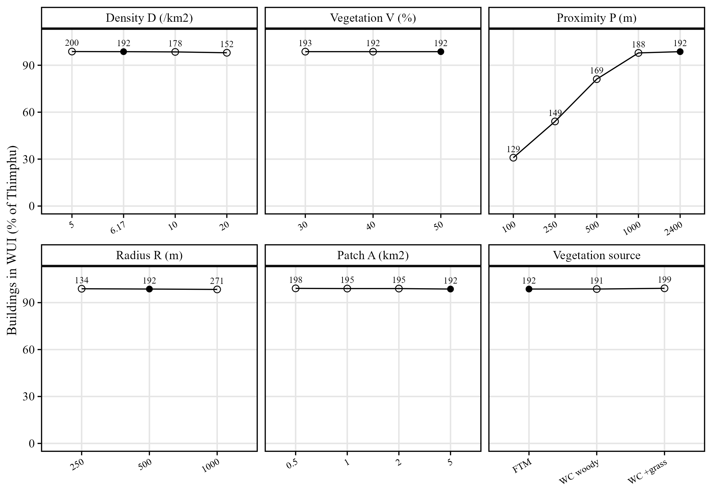
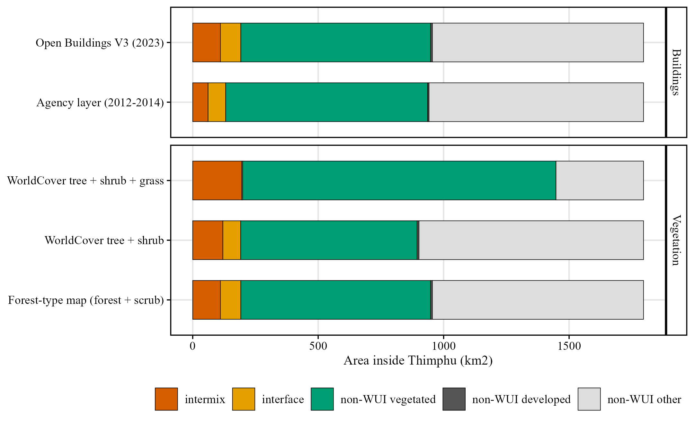
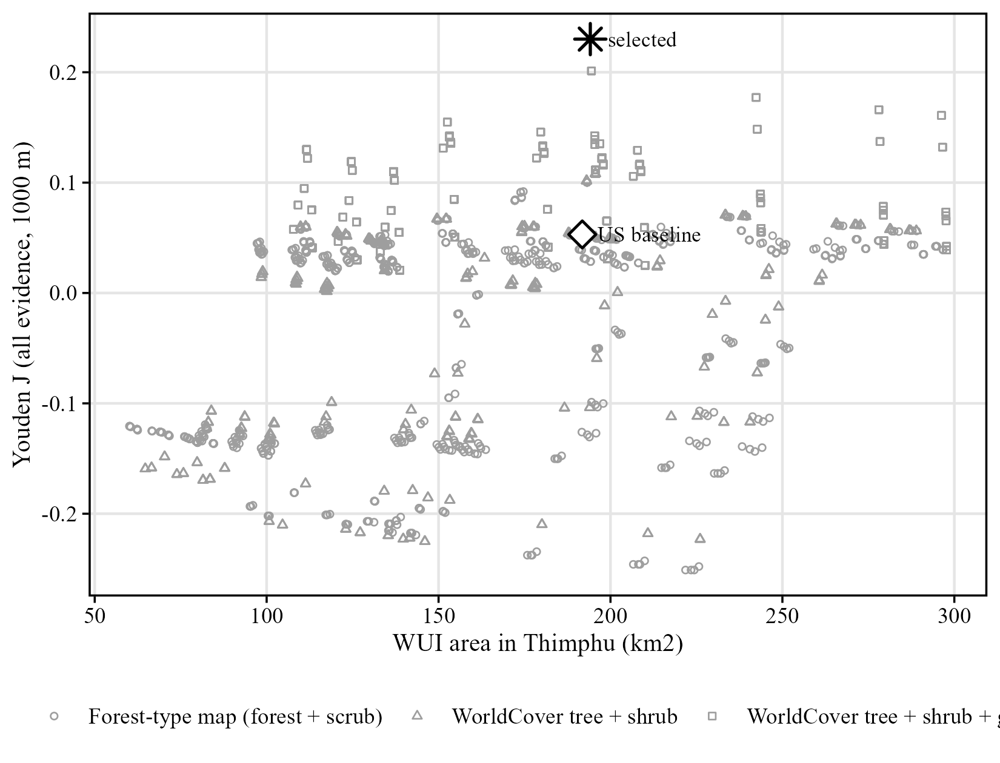
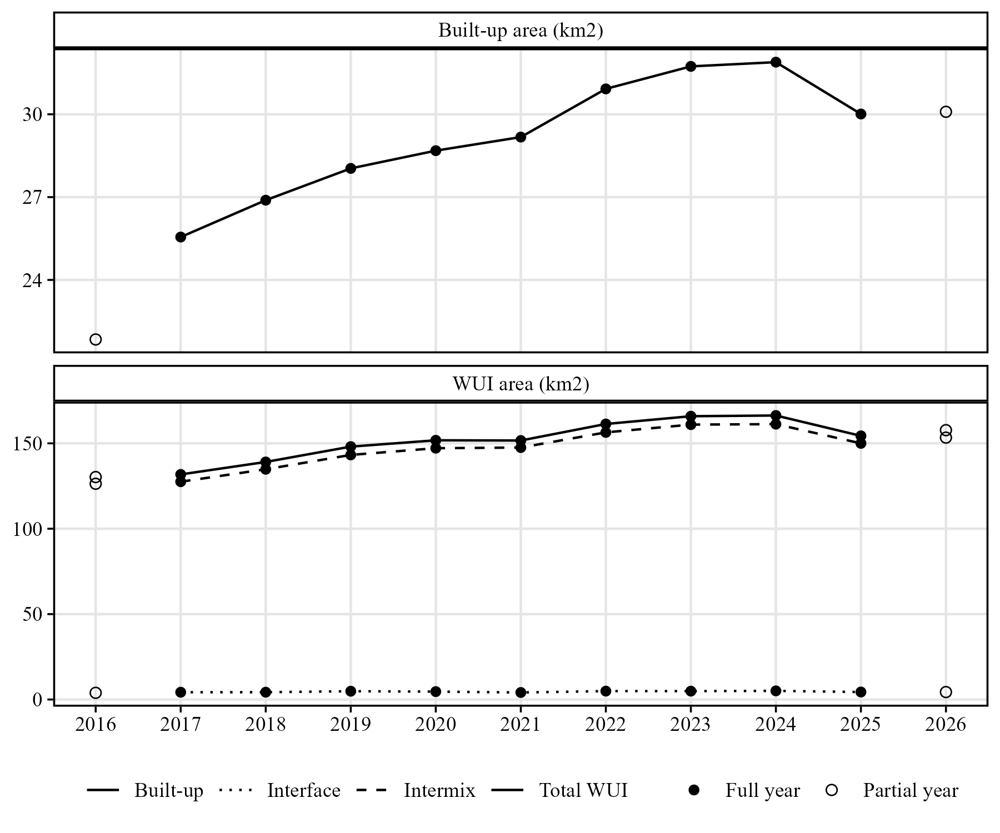
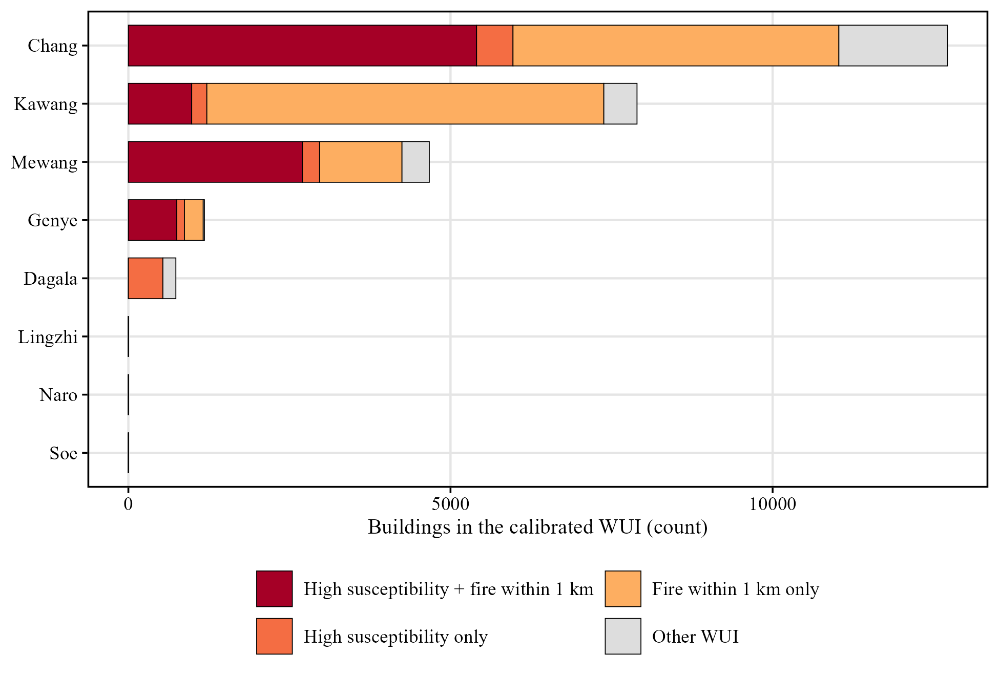

# Thimphu WUI workshop guide

Adapted from the corresponding FIRE–BHUTAN workshop guide PDF. The theory, data notes,
analysis walk-through, exercises and glossary are presented below. The commands use RStudio.
Use the actual workshop layers supplied in the [combined participant ZIP](downloads.html).
The main practicals run from the combined RStudio project. The original analysis
examples in this reference guide use paths within the individual workshop folders.
Some maps and example output are described here and available through the participant project.

[Workshop practical scripts](wui.html#practicals) · [RStudio setup](setup.html)

## Contents

- [Part 1. Background and theory](#part-1)
- [Part 2. GIS concepts in simple language](#part-2)
- [Part 3. Statistics concepts in simple language](#part-3)
- [Part 4. The data in detail](#part-4)
- [Part 5. Setting up and reading the code](#part-5)
- [Part 6. The analysis step by step](#part-6)
- [Part 7. Exercises (with answer notes)](#part-7)
- [Part 8. Limitations, next steps and troubleshooting](#part-8)
- [Glossary](#glossary)
- [Key references](#references)

### Suggested two-day programme

| Day | Session | Content | Time |
|---|---|---|---|
| 1 | 1 | Part 1: fire, the WUI idea and the study questions | 60 min |
| 1 | 2 | Part 2: GIS concepts (raster, grid, neighbourhoods, patches, distance) | 75 min |
| 1 | 3 | Part 3: statistics concepts (confusion matrix, Youden J, cross-validation, kappa, trends) | 75 min |
| 1 | 4 | Part 4: the data; Part 5: setting up RStudio and R, reading R code | 90 min |
| 2 | 5 | Step 02, layers and benchmark: lessons 2.1–2.5, run, read `01-sensitivity` | 75 min |
| 2 | 6 | Step 03, fire association: lessons 3.1–3.5, run, read `02-calibration` | 75 min |
| 2 | 7 | Step 04, change over time: lessons 4.1–4.4, run, read `03-growth` | 60 min |
| 2 | 8 | Step 05, exposure and field kit: lessons 5.1–5.3, run, read `04-exposure`; step 08 audit | 60 min |
| 2 | 9 | Part 7 exercises, Part 8 limitations, discussion | 60 min |

Each step takes 1–5 minutes to run, so participants can start a step, then follow its lessons and code walk-through while it finishes. For a one-day workshop, run all steps at once at the start (about 16 minutes; Part 6.6), then teach from the lessons and the finished folders.

## Part 1. Background and theory

### 1.1 Why fire near settlements matters

Most vegetation fires in Bhutan are started by people: burning to clear land, debris burning, carelessness, and sparks from power lines or roads. Because people start fires where they live and work, fire and settlement come together in space.

In Thimphu dzongkhag, 79% of mapped buildings have some recorded fire evidence (an incident report, a satellite fire detection or a mapped burned area) within 1 km, over 2012–2025. You will compute this number yourself in Lesson 3.1.

Fires near settlements matter for three reasons:

- they threaten houses, people, water supplies and infrastructure;
- they are where fires most often start;
- they are where prevention pays off most: clearing fuel around houses, fire lines, awareness and quick reporting.

### 1.2 What is the wildland–urban interface?

The **wildland–urban interface (WUI)** is land where houses meet or mix with wildland vegetation: forest, shrub and grass. Two kinds are recognised:

- **Intermix:** houses scattered *inside* wildland vegetation. Imagine farmhouses dotted on a forested hillside, with trees and grass all around each one.
- **Interface:** a built-up area *next to* a large block of wildland, with little vegetation inside the built-up area itself. Imagine the edge of a town where the last row of houses faces a forested slope.

```
  INTERMIX                          INTERFACE
  ^ ^ ^ H ^ ^ ^ ^                   H H H H H | ^ ^ ^ ^ ^ ^
  ^ ^ ^ ^ ^ H ^ ^                   H H H H H | ^ ^ ^ ^ ^ ^
  ^ H ^ ^ ^ ^ ^ H                   H H H H H | ^ ^ ^ ^ ^ ^
  ^ ^ ^ ^ H ^ ^ ^                   H H H H H | ^ ^ ^ ^ ^ ^
  houses (H) inside vegetation (^)  town next to a big forest block
```

Land that is not WUI is called non-WUI. This package separates it into three classes:

- **vegetated:** wildland with few or no houses;
- **developed:** a dense built-up area far from large wildland;
- **other:** for example farmland, rock or alpine land.

### 1.3 The theory: the Radeloff definition

The most widely used WUI definition comes from Radeloff and colleagues (2005), who mapped the WUI of the United States. Their rules use three ideas:

| Idea | Their rule | Why |
|---|---|---|
| Enough houses | more than 6.17 houses per km² (16 per square mile) | below this, houses are too sparse to count as a community |
| Enough vegetation (intermix) | at least 50% wildland vegetation | vegetation inside the settlement can carry fire to houses |
| Close to a large wildland block (interface) | within 2.4 km of a block that is at least 75% vegetated and at least 5 km² | 2.4 km is about how far burning embers can fly in a large fire |

This package translates those rules to a raster map of Thimphu (Part 2). The translation needs five settings, named with letters:

| Letter | Setting | Unit | US value |
|---|---|---|---|
| D | building density threshold | buildings per km² | 6.17 |
| V | vegetation cover threshold | % | 50 |
| R | radius of the neighbourhood circle used to measure density and vegetation | m | 500 (chosen by the analyst) |
| A | minimum area of a "large wildland block" (patch) | km² | 5 |
| P | maximum distance from a settlement to such a patch for "interface" | m | 2,400 |

A sixth choice is **which map defines vegetation**: the national forest-type map, or ESA WorldCover with or without grassland.

### 1.4 Three ideas that must stay separate

This is the most important lesson of the workshop:

1. **Physical WUI:** where buildings and vegetation are arranged in a certain pattern. You can map it without any fire data.
2. **Historical fire association:** how close buildings were to past recorded fire. A building near past fire is not a burned building.
3. **Management priority:** where to act first. This combines people, buildings, how fire-prone the land is (susceptibility) and access.

A map can be **reproducible** (anyone gets the same answer) without being **validated** (checked against independent ground truth). This package is reproducible; field validation has not yet been done.

### 1.5 The study questions and where they are answered

| Question | Script (step) | Result folder |
|---|---|---|
| Q1. What does the WUI of Thimphu look like under the US rules, and which settings matter most? | `02_wui_layers.R` | `outputs/01-sensitivity` |
| Q2. Which rule best separates buildings near past fire from buildings far from it, and how reliable is that choice? | `03_fire_calibration.R` | `outputs/02-calibration` |
| Q3. Has the WUI grown between 2016 and 2026? | `04_wui_growth.R` | `outputs/03-growth` |
| Q4. How many buildings and people are in the WUI, which gewogs come first, and how should the map be checked in the field? | `05_exposure_fieldkit.R` | `outputs/04-exposure` |
| Q5. How robust are these answers? | `08_scientific_revision.R` | review tables in `data/derived` |

### 1.6 The main answers (you will reproduce every number)

1. **The US rules put almost every building into WUI.** They class 99% of buildings as WUI, covering 192 km². They cannot tell one settlement from another.
2. **A fire-selected rule separates better, but only a little.** Of 2,160 candidate rules, the one most associated with past fire is density > 20 buildings/km², vegetation ≥ 50% (tree + shrub + grass), within 100 m of a large patch, 1,000 m radius. It maps 194 km² and 91% of buildings. Its Youden J is 0.23 against 0.05 for the US rules, but only 0.108 when each gewog is held out.
3. **Thimphu's WUI is almost all intermix.** 27,058 WUI buildings are intermix and 138 are interface: houses are scattered through grass, scrub and forest.
4. **The WUI appears to be growing.** The satellite land-cover version grew from about 132 km² (2017) to 154 km² (2025), +4.5 km² per year. Part of this may come from more satellite observations in later years, so treat it as provisional.
5. **Exposure.** About 126,600 modelled people live in the mapped WUI. 74.7 km² of WUI (9,841 buildings) combines high fire susceptibility with past fire within 1 km. Chang gewog ranks first; Kawang and Mewang are tied second.
6. **Next step: field checking.** The map is an exploratory scenario. 80 field points have been drawn for checking but not yet visited.

## Part 2. GIS concepts in simple language

### 2.1 Vector and raster data

GIS stores maps in two ways.

- **Vector data** are points, lines and polygons with attributes. In this package:
  - a building is a point (the centre of its footprint);
  - a road is a line;
  - a gewog is a polygon.

  Vector files here are **GeoPackages** (`.gpkg`). One GeoPackage can hold several layers, like sheets in a workbook.
- **Raster data** are grids of square cells, each holding one number, like a photograph made of pixels. Examples: the share of a cell covered by forest, or the number of people in a cell. Raster files here are **GeoTIFFs** (`.tif`).

The analysis turns the vector data (buildings, fire points) into rasters, because neighbourhood calculations on a grid are fast and simple.

### 2.2 Coordinate reference system (CRS)

A **CRS** says how positions on the round Earth are drawn on a flat map. The package uses **EPSG:5266, DRUKREF 03 / Bhutan National Grid**. Its units are metres, so distances (100 m, 1 km) and areas (km²) can be measured directly. Latitude–longitude, by contrast, is in degrees, which are not equal distances on the ground.

### 2.3 The 50 m analysis grid

Every layer is placed on one common grid of **50 m × 50 m cells**:

- **Cell area:** one cell is 2,500 m² = **0.0025 km²**. A mapped area is simply *number of cells × 0.0025 km²*; for example, 400 cells = 1 km².
- **The grid file:** `grid_50m.tif` has 2,093 rows × 1,213 columns. Each cell holds:
  - 2 if it is inside Thimphu dzongkhag (718,649 cells, about 1,797 km²);
  - 1 if it is in a 5 km buffer around Thimphu;
  - empty otherwise.
- **Why a buffer?** A house near the dzongkhag border has neighbours and forest on the other side of the border. Without the buffer, its density and vegetation would be under-counted. This is called an **edge effect**. Results are reported only for cells with value 2.

### 2.4 Neighbourhoods (moving windows)

A single 50 m cell tells you little. Is it in a town or a village? Is it surrounded by forest? To answer, each cell looks at a **circle around itself**, its neighbourhood of radius R, and summarises what is inside. This is called a **focal** or **moving-window** operation: the circle slides over every cell of the map.

Simple example with a 3 × 3 square window. The numbers are buildings per cell, and the window is centred on the middle cell:

```
 0  1  0
 2  3  1      sum of the 9 cells = 0+1+0+2+3+1+0+0+1 = 8 buildings
 0  0  1      window area = 9 cells x 0.0025 km2 = 0.0225 km2
              density = 8 / 0.0225 = 356 buildings per km2
```

The package uses circles of radius 250, 500 or 1,000 m:

| Radius R | Cells in the circle | Area | Buildings needed to exceed D = 20 /km² |
|---|---|---|---|
| 250 m | 81 | 0.20 km² | 5 |
| 500 m | 317 | 0.79 km² | 16 |
| 1,000 m | 1,257 | 3.14 km² | 63 |

So **the radius changes the answer**. Five houses inside 250 m make a "dense" place, but the same five houses spread over 1,000 m do not. You will compute this table in Lesson 2.2.

Two summaries are used:

- **Density** = number of buildings in the circle ÷ circle area.
- **Vegetation cover** = average vegetation share of the cells in the circle, in %.

### 2.5 Shares (fractions) of a cell

Land-cover maps such as WorldCover have 10 m pixels, and 25 of them fit in one 50 m cell. During preparation the package counted, for every 50 m cell, the share of its 10 m pixels in each class. For example: tree 60%, grass 25%, built 15%. Keeping shares instead of a single "main class" keeps more information: a cell that is 45% forest is not treated as having no forest.

### 2.6 Patches and connectivity

The interface rule needs "large wildland blocks". To find them:

1. Mark every cell that is **at least 75% vegetated** (the core cells).
2. Join core cells that touch into **patches**. "Touch" uses **8-connectivity**: a cell connects to its 4 side neighbours and its 4 corner neighbours.

   ```
   4-connectivity      8-connectivity
       . X .               X X X
       X o X               X o X
       . X .               X X X
   ```

3. Measure each patch's area (number of cells × 0.0025 km²) and keep only patches of at least A km².

In Thimphu, one huge connected patch of about 2,385 km² covers most of the land (it continues into the buffer), and the other 1,500 or so are tiny (Lesson 2.4). That is why the patch size A hardly matters here: almost everywhere is near the one big patch.

### 2.7 Distance rasters

For every cell, a **distance raster** stores the straight-line distance in metres to the nearest cell of a target. Here the targets are large patches (step 02) or fire evidence (step 03). A cell inside the target has distance 0.

### 2.8 Rasterising

**Rasterising** turns vector data into a raster:

- **Points:** a building point lands in exactly one cell. Counting points per cell gives a building-count raster (Lesson 2.1).
- **Polygons:** a burned-area polygon marks every cell it touches.

### 2.9 Zonal summaries

A **zonal summary** adds up or averages raster cells within zones, such as gewogs. Examples: WUI area per gewog, or people in WUI per gewog. The gewog of each cell comes from `gewog_50m.tif`.

### 2.10 Resampling: putting different grids on one grid

Inputs come at different cell sizes (10 m, about 100 m). Moving them onto the 50 m grid is called **resampling**, and the method depends on what the numbers mean:

| Data type | Example | Method | Why |
|---|---|---|---|
| Categories | susceptibility class 1–5 | nearest neighbour | a class cannot be averaged (class 2.5 means nothing) |
| Continuous values | walking time in hours | bilinear (smooth average) | values change gradually |
| Counts | people per cell | convert to density, average, convert back | so that the total number of people is kept |
| Land cover | WorldCover 10 m classes | count shares | keeps mixed cells mixed |

Resampling never adds detail: a 100 m layer resampled to 50 m is still 100 m information.

## Part 3. Statistics concepts in simple language

### 3.1 Map versus reference: the confusion matrix

To judge a map, compare it with a **reference**: something else we believe tells us the answer. In step 03 the "map" is *is this building in WUI?*. The reference is *was there fire evidence within 1 km of this building in 2012–2025?*

Each building falls into one of four boxes:

| | Reference: fire within 1 km | Reference: no fire within 1 km |
|---|---|---|
| **Map: WUI** | TP, true positive | FP, false positive |
| **Map: not WUI** | FN, false negative | TN, true negative |

This 2 × 2 table is a **confusion matrix**.

**Worked example with 10 buildings.** Six have fire nearby and four do not. The map puts five of the six fire buildings in WUI (TP = 5, FN = 1). It also puts two of the four no-fire buildings in WUI (FP = 2, TN = 2).

### 3.2 Sensitivity, specificity and Youden J

- **Sensitivity** = TP / (TP + FN): of the buildings with fire nearby, the share the map calls WUI. Example: 5 / 6 = 0.83.
- **Specificity** = TN / (TN + FP): of the buildings without fire nearby, the share the map calls non-WUI. Example: 2 / 4 = 0.50.
- **Youden J** = sensitivity + specificity − 1. Example: 0.83 + 0.50 − 1 = 0.33.

J runs from 0 (the map is no better than labelling buildings at random) to 1 (perfect separation). It can even be negative (worse than random).

J is used because it gives equal weight to both kinds of building. A rule that calls **every** building WUI has sensitivity 1 but specificity 0, so J = 0. That is exactly the weakness of the US rule in Thimphu (J = 0.05).

Other measures you will meet:

- **Positive predictive value (PPV)** = TP / (TP + FP): of the buildings the map calls WUI, the share that have fire nearby.
- **Negative predictive value (NPV)** = TN / (TN + FN): of the buildings the map calls non-WUI, the share with no fire nearby.
- **Balanced accuracy** = (sensitivity + specificity) / 2.

### 3.3 The base-rate trap

In Thimphu, 79% of buildings have fire within 1 km. Because of this, almost any map that includes most buildings will look "accurate" by PPV (about 80%) simply because most buildings are near fire anyway. That is why the guide uses J, which is not fooled by this.

Also remember what the reference is. A "false positive" building (mapped WUI, no fire nearby) may be a perfectly real WUI house that has simply not had a fire close by **yet**. The reference is past fire, not truth.

### 3.4 Searching many rules and the danger of over-fitting

Step 03 tries every combination of the settings:

| Setting | Values tried | Count |
|---|---|---|
| D (buildings/km²) | 5, 6.17, 10, 20 | 4 |
| V (%) | 30, 40, 50 | 3 |
| P (m) | 100, 250, 500, 1,000, 2,400 | 5 |
| R (m) | 250, 500, 1,000 | 3 |
| A (km²) | 0.5, 1, 2, 5 | 4 |
| Vegetation map | forest-type map, WorldCover tree + shrub, WorldCover tree + shrub + grass | 3 |

That gives 4 × 3 × 5 × 3 × 4 × 3 = **2,160 rules**, each scored with J, and the best one is chosen.

When you pick the best of many tries **using the same data you score them on**, the winning score is too optimistic. Some of its success is luck that fits these particular buildings. This is **over-fitting**. Its score should be checked on data that were not used to choose it.

**Tie-breaking.** Several rules can have exactly the same J. The package then prefers the rule with the fewest changes from the US settings, and then the smaller WUI area. That is why A = 5 km² was "chosen": rules with A = 0.5, 1 and 2 km² score the same (Lesson 3.3).

### 3.5 Cross-validation: leave one gewog out

**Cross-validation** checks over-fitting. Thimphu has 8 gewogs, and for each one in turn:

1. Hide that gewog's buildings.
2. Choose the best rule using only the other 7 gewogs.
3. Score that rule on the hidden gewog.

Adding up the hidden-gewog results gives an **out-of-fold J**: an honest estimate of how well the *method of choosing a rule* works on new places. For Thimphu it is **0.108**, about half the in-sample 0.230. Part of the gain was real and part was luck.

Whole gewogs are held out, not single buildings, because neighbouring buildings share the same fires. Holding out one house while its neighbour stays in would barely test anything.

### 3.6 Bootstrap: how uncertain is a number?

The **bootstrap** estimates uncertainty by repeating the calculation on resampled data:

1. Draw 8 gewogs at random **with replacement**, so some gewogs appear twice and some not at all.
2. Recompute J for the chosen rule on that sample.
3. Repeat 1,000 times.

The middle 95% of the 1,000 J values is a **95% confidence interval**. Resampling whole gewogs, not buildings, is called a **cluster bootstrap**, for the same reason as above. With only 8 gewogs the interval is wide: for the selected rule, roughly 0.12 to 0.34.

### 3.7 Cohen's kappa: agreement beyond chance

When two maps label the same cells, the **agreement** is the share of cells where they match. But some agreement happens by chance: if 90% of both maps is "no", they will match on many cells even if they are unrelated. **Cohen's kappa** removes that chance agreement:

kappa = (observed agreement − chance agreement) / (1 − chance agreement)

**Worked example.** Two maps of 100 cells match on 90. Map 1 says "yes" on 20 cells and map 2 on 25. Chance agreement = (0.20 × 0.25) + (0.80 × 0.75) = 0.65. So kappa = (0.90 − 0.65) / (1 − 0.65) = 0.71.

A rough guide: 0.2 is weak, 0.6 good, 0.8 or more very good. Step 04 uses kappa to choose the settlement threshold (kappa 0.88).

### 3.8 Trends: Theil–Sen slope and Kendall's test

To ask whether WUI area grows over the years, the package uses two simple, robust methods:

- **Theil–Sen slope.**
  1. Take every pair of years. With 9 years (2017–2025) there are 36 pairs.
  2. For each pair, compute the slope (change in area ÷ change in years).
  3. The **median** of the 36 slopes is the trend.

  One strange year cannot pull the median much, unlike an ordinary straight-line fit.
- **Kendall's tau and its p-value.**
  - **Tau** compares every pair of years and counts how often the later year is higher. It is 1 if area always rises, 0 if there is no pattern, and −1 if it always falls.
  - **The p-value** is how likely a pattern this strong would be if there were no trend. A small p (below 0.05) suggests a real trend.

  The test does not know about satellite errors, so a small p does not prove that houses were built.

### 3.9 Wilson confidence interval for a percentage

When a figure shows "83% of WUI buildings have fire nearby", the **Wilson interval** gives the plausible range of that percentage. It behaves well even for small groups and for percentages near 0% or 100%.

### 3.10 Ranks

To combine indicators measured in different units (buildings, people), the package **ranks** the gewogs on each indicator: 1 = largest. It then averages the ranks. Tied values share the average rank, and a smaller average rank means higher priority. Ranks ignore the size of differences: first and second place could differ by 1 building or by 10,000.

### 3.11 Probability sampling for field checking

To estimate map accuracy from field visits without bias, the field points must be chosen by a **probability sample**: every place has a known chance of being chosen, and that chance is used as a weight in the calculations. **Stratified random sampling** draws a fixed number of points at random within each map class (each stratum). Picking convenient, roadside points instead would bias the result.

## Part 4. The data in detail

All inputs were taken from data already in the FIRE-BHUTAN project, cropped to Thimphu and its 5 km buffer, put on the 50 m grid where needed, and saved in `data/inputs/`. This preparation was done once by `scripts/01_prepare_inputs.R`; the workshop does not need to repeat it. Lesson 1.1 lists every input on screen.

### 4.1 Study area

| Item | Detail |
|---|---|
| Files | `study_area.gpkg`: layers `dzongkhag` (1 polygon), `context_buffer` (1), `gewogs` (9); `grid_50m.tif`; `gewog_50m.tif` |
| Gewogs | Chang, Dagala, Genye, Kawang, Lingzhi, Mewang, Naro, Soe, plus "Outside gewog polygons" (thin slivers, 2.8 km²) |
| Note | Thimphu city lies inside the Chang, Kawang and Mewang gewog polygons. Gewog outlines were dissolved from the DoFPS forest-type map; they are close to, but not exactly, official boundaries. |

### 4.2 Buildings

| Item | Detail |
|---|---|
| Main source | **Google Open Buildings V3**. A computer model traced building footprints on high-resolution satellite images. Each footprint has a **confidence** score from 0.65 to 1: how sure the model is that it is a real building. |
| File | `buildings.gpkg`, layer `open_buildings_v3`: 40,513 points in Thimphu plus buffer; fields `full_plus_code` (ID), `confidence`, `area_m2` |
| Filter | only confidence ≥ 0.70 is used: 34,646 in Thimphu plus buffer, **29,799 inside Thimphu** |
| Representation | each footprint becomes one point at its centre, so a building is counted once whatever its size |
| Second source | `agency` layer: 13,529 national building points, mostly edited in 2012–2014. Used only as a check, because it is older. |
| Limitations | A model, not a survey: some sheds may be counted, and some houses under trees may be missed. Image dates vary but are labelled 2023. Confidence thresholds have not been tested for Bhutan. |

### 4.3 Vegetation

| Item | Detail |
|---|---|
| File | `vegetation_shares_50m.tif`, 6 layers: share (0–100%) of each 50 m cell in each class |
| `ftm_forest_scrub` | from the **DoFPS forest-type map**: every class except "Non Forest" (forest and scrub) |
| `wc_tree`, `wc_shrub`, `wc_grass`, `wc_crop`, `wc_built` | from **ESA WorldCover 2021 v200**, a global 10 m land-cover map made from Sentinel-1 and Sentinel-2 satellite images |
| Three vegetation definitions | **ftm** = forest-type map forest + scrub (the US-type baseline); **wc_woody** = WorldCover tree + shrub; **wc_woody_grass** = WorldCover tree + shrub + grass |
| Why grass matters | In Thimphu, grass and scrub carry most of the mapped burned area, so a fire-relevant definition may need grass. |
| Limitation | Land cover is not fuel. A "grass" pixel says nothing about how dry, tall or continuous the grass is. WorldCover grass also mixes natural grassland, pasture and fallow fields. |

### 4.4 Annual land cover: Dynamic World

| Item | Detail |
|---|---|
| Source | **Google Dynamic World**: every Sentinel-2 image (10 m) is classified into 9 land-cover classes. For each year the package took the **most frequent class** of each 10 m pixel, then computed 50 m shares. |
| Files | `dynamic_world/dw_2016_shares_50m.tif` … `dw_2026_shares_50m.tif`; layers `trees`, `grass`, `crops`, `shrub`, `built`, `bare`, `water`, `valid_obs` |
| `valid_obs` | the average number of cloud-free observations per pixel that year: 3.3 in 2017, 11.6 in 2025 |
| Partial years | 2016 starts in October and 2026 ends at the download date, so both are shown but left out of trend tests |
| Limitation | Annual labels change through classification "noise" as well as real change. More observations in later years can change the labels by themselves. |

### 4.5 People, roads, access and susceptibility

| Data | File | Source and preparation | Limitation |
|---|---|---|---|
| Population | `population_2020_50m.tif` (`people`) | **WorldPop 2020 constrained**: a model that spreads census totals over cells that contain buildings, about 100 m. Converted to density, moved to the 50 m grid, converted back to people per cell. | Modelled, for 2020, not a census of 2026. Some settled gewogs (Genye, Dagala) get zero people. |
| Roads | `roads_osm.gpkg` (3,788 lines) | **OpenStreetMap** roads | Completeness and road condition vary. |
| Walking time | `walk_time_h_50m.tif` | Parent project's model of hours of walking to the nearest road, 100 m, resampled bilinearly | Walking, not fire-engine, time. |
| Susceptibility | `susceptibility_class_50m.tif` (`local_class`, 1–5) | Parent project's random-forest model of where satellite fires occurred, from terrain, land cover, human access and fire weather. Classes are quantiles; 4–5 = the top 15% of cells. | It was trained on fire detections, so it is related to the fire evidence used in step 03. It is not a probability. |

### 4.6 Fire evidence, 2012–2025

| Layer in `fire_evidence.gpkg` | Count | What it is | Main limitation |
|---|---|---|---|
| `dofps_points` | 33 | Forest fire incidents reported by the Department of Forests and Park Services, with location, date, area and cause | Locations and dates can be approximate; small fires may not be reported. |
| `firms_points` | 795 | NASA **FIRMS** active-fire detections from the MODIS (1 km) and VIIRS (375 m) satellites, kept only at nominal or high confidence and screened as likely vegetation fires | A detection is a hot pixel, not a fire. One fire can give dozens of detections, and agricultural burning can be included. |
| `burned_patches` | 21 (about 1,178 ha) | Burned areas mapped from satellite images by the burn severity package | Several patches can belong to one fire. |

The three layers can be combined as "records" (DoFPS + patches), "firms", or "all" (both). The main analysis uses **all** evidence within **1 km** of a building.

### 4.7 The settings file `config/settings.json`

Every number the analysis uses is in one text file, so nothing is hidden in the code. Open it from RStudio:

```r
file.show("config/settings.json")
```

| Section | What it controls |
|---|---|
| `study_area` | CRS (EPSG:5266), 5 km buffer |
| `grid` | 50 m analysis cell, 10 m fine cell |
| `buildings` | confidence ≥ 0.70 (and the values 0.65–0.80 tested) |
| `baseline` | the US-type rule: D 6.17, V 50, P 2,400, R 500, A 5, vegetation `ftm` |
| `patch_vegetation_share` | 0.75: a cell must be ≥ 75% vegetated to be part of a patch |
| `sensitivity_grid` | the values of D, V, P, R, A and vegetation tried (Part 3.4) |
| `fire_evidence` | period 2012–2025, exposure distance 1,000 m (500 and 2,000 m tested), FIRMS confidence filters |
| `growth` | full years 2017–2025, partial years 2016 and 2026, built-share thresholds tested, calibration year 2023 |
| `exposure` | susceptibility classes 4–5 = high; remote = more than 1 h walk |
| `field_kit` | target points per class (40, 40, 25, 15, 20) and minimum spacing 300 m |

**Do not edit the settings during the workshop.** Exercise 6 shows how to explore other rules without changing anything.

## Part 5. Setting up and reading the code

### 5.1 Prepare the workshop project

1. Download the real-data project ZIP from the organizer's Google Drive link and extract the whole archive.
2. Open `Bhutan_Forest_Fire_Workshops.Rproj` in RStudio. Run `01_Install_Workshop_Packages.R` once before going offline.
3. Open `r_studio_run/` in RStudio. Select a section and press **Ctrl+Enter** or click **Source** to execute the complete file.

### 5.2 Inspect outputs and run the stages

Open the practical named for the output folder you need. Its default is to work directly
with the reviewed real-data outputs in the ZIP. In a separate working copy, change
`rebuild <- FALSE` to `TRUE` in Block 10 to regenerate the result.

The commands below also work when an instructor opens the individual workshop project.

```r
source("START_HERE.R")
check_project("02")
## Run only after preflight reports PASS.
run_project("02")
```

Long stages print a log path under `logs/`. The lessons are available while you wait.
Each workbook in `process_data/` provides the values behind its figure.

### 5.3 Read the R code

Use `str()` to inspect columns, `head()` for a preview and `summary()` to check ranges
before calculating. `terra` reads raster grids and `sf` reads spatial features.
The project's shared files open the input paths relative to the project folder.
Keep returned field forms in a separate folder before replaying a field-design stage.

### 5.4 Reading R code in ten minutes

You do not need to write R, but you will read pieces of it. These are the patterns used:

| R code | Meaning |
|---|---|
| `x <- 5` | store 5 in `x` (`<-` means "becomes") |
| `c(250, 500, 1000)` | a list of values (a **vector**) |
| `x[3]`, `x[x > 0]` | the 3rd value; the values greater than 0 |
| `a %in% c(1, 2)` | TRUE where `a` is 1 or 2 |
| `sum()`, `mean()`, `median()`, `max()` | the usual summaries; `na.rm = TRUE` skips empty cells |
| `ifelse(test, yes, no)` | choose a value cell by cell |
| `function(x) { ... }` | a small reusable recipe |
| `for (r in c(250, 500)) { ... }` | repeat for each value |
| `lapply(list, function)` | apply a recipe to every item and collect the results |
| `do.call(rbind, ...)` | stack many small tables into one |
| `sprintf("%.1f km2", 3.14159)` | build text from numbers, here "3.1 km2" |
| `CFG$baseline$D` | the value D inside the `baseline` section of the settings |
| `# text` | a comment, ignored by R, written for people |

The GIS work uses two packages:

| Function | Package | What it does |
|---|---|---|
| `st_read(file, layer)` | sf | read a vector layer from a GeoPackage |
| `st_coordinates(x)` | sf | x/y coordinates of points |
| `st_write(x, file, layer)` | sf | write a vector layer |
| `rast(file)` | terra | open a raster |
| `values(r)` | terra | the cell values as a long list |
| `cellFromXY(r, xy)` | terra | which cell contains each point |
| `focal(r, w, fun = "sum")` | terra | moving-window summary with window `w` |
| `patches(r, directions = 8)` | terra | join touching cells into numbered patches |
| `freq(r)` | terra | count cells per value |
| `distance(r)` | terra | distance from every cell to the nearest non-empty cell |
| `classify(r, table)` | terra | recode values using a from → to table |
| `mask(r, m)` | terra | empty `r` wherever `m` is empty |
| `rasterize(v, r)` | terra | burn vector features into a raster |
| `cover(a, b)` | terra | fill the empty cells of `a` with values from `b` |
| `writeRaster(r, file)` | terra | save a raster to a GeoTIFF |

### 5.5 The shared helper file `R/tw_common.R`

Every analysis script starts by loading this file. It is short, and its key parts are:

```r
TW <- local({
  if (file.exists("config/settings.json")) "."
  else if (file.exists("thimphu_WUI/config/settings.json")) "thimphu_WUI"
  else stop("Run from the parent project root or from inside thimphu_WUI/.")
})
```

This finds the package folder, so the scripts work wherever the folder is copied. `tw("data/inputs")` then builds paths inside it.

```r
CFG <- read_json(tw("config/settings.json"), simplifyVector = TRUE)
CRS <- CFG$study_area$crs
RES <- CFG$grid$resolution_m
```

This reads the settings file once; every script uses `CFG`.

```r
classify_wui <- function(d, v, p, D, V, P) {
  out <- ifelse(d > D, ifelse(v >= V, 1L, ifelse(p <= P, 2L, 4L)), ifelse(v >= V, 3L, 5L))
  out[is.na(d) | is.na(v)] <- NA_integer_
  out
}
```

**This is the WUI rule in one line.** It needs density `d`, vegetation `v` and patch distance `p` for each cell, and the thresholds D, V and P. Read it as a decision tree:

```
density > D ?
 |-- yes: vegetation >= V ?
 |        |-- yes -> 1 intermix
 |        |-- no : patch within P ?
 |                 |-- yes -> 2 interface
 |                 |-- no  -> 4 non-WUI developed
 |-- no : vegetation >= V ?
          |-- yes -> 3 non-WUI vegetated
          |-- no  -> 5 non-WUI other
```

Cells without data get no class (`NA`).

```r
circle_w <- function(g, r) { w <- focalMat(g, r, "circle"); w[w > 0] <- 1; w }
```

This makes the **circle window** of radius `r`: a small grid of 1s (inside the circle) and 0s (outside), used by `focal()`.

The other helpers are:

- `wilson_ci()`: the Wilson interval (Part 3.9).
- `md_kappa()`: agreement and kappa (Part 3.7).
- `write_json_pretty()`: saves results as JSON.

### 5.6 The figure and table helpers in `R/sci_figure.R`

These functions give every step the same output folder layout:

| Function | What it produces |
|---|---|
| `sci_run(slug, title)` | sets up the output folder, for example `outputs/01-sensitivity` |
| `save_fig(run, plot, n, name, data, caption)` | saves figure n as PNG, JPG and PDF, saves the data behind it as `process_data/fig_0n_data.xlsx`, and adds its caption to `captions.md` |
| `write_process(run, table, name)` | saves an intermediate table to `process_data/NN_name.xlsx` |
| `data_health(run, table, name)` | checks a table for missing values, outliers and strongly related columns |
| `write_health(run, notes)` | writes those checks and notes to `00_data_health.md` |
| `build_report(run)` | would combine everything into `report.pdf`; skipped in the workshop |

So each result folder contains:

```
outputs/01-sensitivity/
  figures/png/fig_01_....png     figures (also jpg/ and pdf/)
  process_data/fig_01_data.xlsx  the numbers behind each figure
  process_data/01_....xlsx       intermediate tables
  captions.md                    figure captions with the key numbers
  00_data_health.md              data checks and notes on limitations
  report.pdf                     (older combined report, not rebuilt in the workshop)
```

### 5.7 Check your laptop

Source `START_HERE.R` and call `check_project()` in the RStudio Console. Resolve missing packages or files before rebuilding.

## Part 6. The analysis step by step

Each step below follows the same pattern:

1. aim and inputs;
2. lessons to run and understand;
3. running the real step;
4. a walk through its code;
5. what is in its output folder, and how to read each figure;
6. check questions.

Steps must run in order (02 → 03 → 04 → 05 → 08), because each uses the previous step's files. The package already contains the results of all steps, so the lessons work even before you run anything.

### 6.1 Step 02: building the WUI layers and the US-type benchmark

**Aim.** For every 50 m cell, compute building density, vegetation cover and distance to large patches, at every setting to be tested. Then map the WUI under the US-type rule and see which setting changes the result most.

**Inputs.** Buildings, vegetation shares, the grid and gewogs.

**Outputs.**

- `data/derived/layers/` (neighbourhood layers used by every later step);
- `data/derived/wui_class_baseline_50m.tif`;
- `data/derived/results_layers.json`;
- `outputs/01-sensitivity/`.

#### 6.1.1 Lesson 2.1: counting buildings in each cell

```r
source("r_studio_run/lesson-2-1.R")
```

The code (from `scripts/workshop_lessons.R`, the same method as step 02):

```r
ob <- ob[ob$confidence >= CFG$buildings$confidence_min, ]            # keep reliable footprints only
cell <- cellFromXY(g, st_coordinates(ob))                            # which cell is each building centre in?
n <- tabulate(cell[!is.na(cell)], ncell(g))                          # how many buildings per cell
bcount <- rast(g); values(bcount) <- n; bcount <- mask(bcount, g)    # put the counts back on the map
```

1. Keep the footprints with confidence ≥ 0.70.
2. Find the grid cell that contains each building's centre point.
3. `tabulate` counts how many buildings fall in each cell number.
4. Write the counts into an empty copy of the grid, and empty the cells outside the study area.

Expected output:

```
Buildings placed on the grid: 34,646
Cells with at least one building: 14,657 (36.6 km2)
Most buildings in one 50 m cell: 21
```

**Discuss.** Only about 37 km² of 50 m cells contain a building, yet the WUI will turn out to be about 190 km². Why? Because the WUI is defined by the *neighbourhood*: a cell with no house can still be in a dense, vegetated neighbourhood. Open `logs\lesson_2.1_building_count.png` to see the counts in a 10 × 10 km window around Thimphu city.

#### 6.1.2 Lesson 2.2: neighbourhood density at three radii

```r
source("r_studio_run/lesson-2-2.R")
```

```r
w <- circle_w(g, r)                                               # circle of 1s: the neighbourhood
area <- sum(w) * km2                                              # its area in km2
d <- focal(bc, w, fun = "sum", na.rm = TRUE) / area               # buildings in circle / circle area
```

For each radius the code makes the circle window, computes its area, then slides it over the map, adding the buildings inside and dividing by the area.

Expected output:

```
R =  250 m: circle =  81 cells = 0.203 km2 | median density where built-up: 637 /km2 | cells above D=20: 37%
R =  500 m: circle = 317 cells = 0.793 km2 | median density where built-up: 567 /km2 | cells above D=20: 47%
R = 1000 m: circle = 1257 cells = 3.143 km2 | median density where built-up: 480 /km2 | cells above D=20: 56%
Smallest whole number of buildings that exceeds D=20 in each circle: 250 m -> 5, 500 m -> 16, 1000 m -> 63
```

**Discuss.**

- **Bigger circles cover more of the map.** A larger radius smooths density, so more cells pass the density threshold (37% → 56% of the window).
- **Density alone excludes almost nothing.** In-town densities are hundreds of buildings per km², far above the US threshold of 6.17, so the density rule filters out almost no settlement in Thimphu.

#### 6.1.3 Lesson 2.3: vegetation cover around each cell

```r
source("r_studio_run/lesson-2-3.R")
```

```r
VEG <- list(ftm = vs[["ftm_forest_scrub"]], wc_woody = vs[["wc_tree"]] + vs[["wc_shrub"]],
            wc_woody_grass = vs[["wc_tree"]] + vs[["wc_shrub"]] + vs[["wc_grass"]])
vp <- 100 * focal(VEG[[v]], w, fun = "mean", na.rm = TRUE)          # mean share in the circle, as %
```

The three vegetation definitions are built by adding share layers. Then, for each one, the average share inside a 1 km circle is computed for every cell.

Expected output (city window, 1 km radius):

```
Forest-type map (forest + scrub)     mean cell share 61% | cells with >= 50% cover within 1 km: 62%
WorldCover tree + shrub              mean cell share 66% | cells with >= 50% cover within 1 km: 68%
WorldCover tree + shrub + grass      mean cell share 92% | cells with >= 50% cover within 1 km: 98%
```

**Discuss.** Once grass counts as wildland, almost every neighbourhood, even around the city, is at least 50% vegetated. So with this definition, dense cells become **intermix**, not interface. This single choice explains why Thimphu's selected WUI is almost all intermix.

#### 6.1.4 Lesson 2.4: large patches and distance to them

```r
source("r_studio_run/lesson-2-4.R")
```

```r
core <- ifel(veg >= CFG$patch_vegetation_share, 1, NA)              # cells at least 75% vegetated
pid <- patches(core, directions = 8, zeroAsNA = TRUE)                # join touching cells (8 neighbours) into patches
pa <- freq(pid); pa$km2 <- pa$count * km2                            # size of every patch
big <- classify(pid, cbind(pa$value, ifelse(pa$km2 >= 5, 1, NA)))     # keep only patches of 5 km2 or more
dist <- distance(crop(big, window()))                                # metres from every cell to the nearest big patch
```

1. Mark cells that are at least 75% vegetated.
2. Number the connected groups (patches).
3. Count each patch's cells to get its area.
4. Keep only patches of 5 km² or more.
5. Measure the distance from every cell to them.

Expected output:

```
Patches found: 1,515 | largest 2385 km2 | patches >= 5 km2: 1 | patches < 0.5 km2: 1,505
In the city window: cells inside a big patch 88%, within 100 m 6%, within 500 m 11%, farther than 1 km 0%
```

**Discuss.**

- **One giant patch.** It covers most of the land and reaches into every valley, so every settlement is within a short distance of a "large wildland block".
- **P matters more than A.** The patch size A hardly changes anything here, but the distance P can.

#### 6.1.5 Lesson 2.5: classifying cells

```r
source("r_studio_run/lesson-2-5.R")
```

The lesson first classifies five hand-made cells with `classify_wui()`:

```
  cell density veg_pct patch_m             class
1    A      30      65      80          intermix
2    B      30      20      80         interface
3    C      30      20     300 non-WUI developed
4    D       5      70      80 non-WUI vegetated
5    E       5      20      80     non-WUI other
```

Check each row against the decision tree in Part 5.5.

It then classifies the city window under the US rule and the fire-selected rule, reading the layers saved by step 02:

```
US baseline    intermix 21.5 km2 | interface 32.1 km2 | non-WUI vegetated 40.3 km2 | non-WUI developed 0.0 km2 | non-WUI other 6.2 km2
Fire-selected  intermix 55.3 km2 | interface 0.1 km2 | non-WUI vegetated 43.1 km2 | non-WUI developed 1.5 km2 | non-WUI other 0.0 km2
```

> **Participant figure.** Lesson 2.5: the same 10 × 10 km window around Thimphu city classified under the US-type rule (left) and the fire-selected rule (right). See `logs/lesson_2.5_classes.png` in the workshop working copy after the corresponding stage or lesson.

**Discuss.** Under the US rule, the forest-type map treats much of the urban area as non-forest, so the city becomes interface. Under the fire-selected rule (grass counts, 1 km radius), the same area becomes intermix. The houses are the same; only the definition changed.

#### 6.1.6 Run step 02

```r
source("START_HERE.R")
check_project("02")
## Proceed after preflight reports PASS.
run_project("02")
```

This took 2.8 minutes on the development laptop. You will see `layers: ftm`, `layers: wc_woody` and `layers: wc_woody_grass` as each vegetation definition is finished, then `Outputs: ./outputs/01-sensitivity`.

#### 6.1.7 Code walk-through: `scripts/02_wui_layers.R`

Open it with `notepad scripts\02_wui_layers.R`. It has five blocks.

**Block 1: settings and building counts (lines 17–33).**

```r
SLUG <- "01-sensitivity"
G <- CFG$sensitivity_grid; B <- CFG$baseline; CONF <- CFG$buildings$confidence_min; PV <- CFG$patch_vegetation_share
ob <- ob_all[ob_all$confidence >= CONF, ]
cell_ob <- cellFromXY(g, st_coordinates(ob)); cell_ag <- cellFromXY(g, st_coordinates(ag))
bcount <- count_r(cell_ob); acount <- count_r(cell_ag)
```

This names the output folder, reads the tested values (`G`) and the baseline rule (`B`) from the settings, and makes building-count rasters for both building sources (Lesson 2.1).

**Block 2: neighbourhood layers (lines 41–58).**

```r
for (r in G$R) { w <- circle_w(g, r); a <- sum(w) * (RES / 1000)^2
  dens[[as.character(r)]] <- focal(bcount, w, fun = "sum", na.rm = TRUE) / a ... }
for (v in names(VEG)) {
  vp <- rast(lapply(G$R, function(r) 100 * focal(VEG[[v]], circle_w(g, r), fun = "mean", na.rm = TRUE)))
  pid <- patches(ifel(VEG[[v]] >= PV, 1, NA), directions = 8, zeroAsNA = TRUE)
  pd <- rast(lapply(G$A, function(a) mask(distance(classify(pid, ...)), g)))
  writeRaster(...)
```

These are Lessons 2.2–2.4, done for every radius (3), every vegetation definition (3) and every patch size (4), over the whole map. The results are saved in `data/derived/layers/`:

- `density_ob.tif` and `density_agency.tif`: 3 layers each, `r250`, `r500`, `r1000`;
- `vegpct_<veg>.tif`: 3 radii each;
- `patchdist_<veg>.tif`: 4 patch sizes each, `a0.5` … `a5`.

**Steps 03–05 never recompute these; they read them.**

**Block 3: classification and one-at-a-time sensitivity (lines 61–78).**

```r
cls <- function(x, agency = FALSE) classify_wui(LD(x$R, agency), LV(x$veg, x$R), LP(x$veg, x$A), x$D, x$V, x$P)
base_cl <- cls(base)
oat <- ... lapply(c("D", "V", "P", "R", "A", "veg"), function(par) ... lapply(G[[par]], function(val) {
  x <- base; x[[par]] <- val; cl <- cls(x); w <- cl %in% 1:2 ...
```

`cls()` picks the right saved layers for a rule and calls `classify_wui()`. The **one-at-a-time** loop starts from the US rule, changes **one** setting at a time to each tested value, and records WUI area and share of buildings. That shows which setting matters most.

**Block 4: source checks (lines 81–94).**

- The baseline is repeated with the older agency buildings, and with each of the three vegetation definitions.
- Agreement and kappa between vegetation definitions are computed.
- Buildings are counted at each confidence level (0.65–0.80).

**Block 5: outputs (lines 97–193).**

- Saves the baseline class raster.
- Runs the data health checks.
- Draws the four figures with `save_fig()`.
- Writes five process tables and `results_layers.json`.

#### 6.1.8 Reading `outputs/01-sensitivity`

| File | Content |
|---|---|
| `figures/png/fig_01_building_density.png` | building density map |
| `figures/png/fig_02_wui_baseline_map.png` | WUI under the US-type rule |
| `figures/png/fig_03_sensitivity_one_at_a_time.png` | effect of each setting |
| `figures/png/fig_04_source_checks.png` | building and vegetation sources compared |
| `process_data/01_building_counts_by_source_and_confidence.xlsx` | buildings in Thimphu at confidence 0.65, 0.70, 0.75, 0.80, and in the agency layer |
| `process_data/02_source_checks_class_area_buildings.xlsx` | class area and buildings for each source |
| `process_data/03_vegetation_definition_agreement.xlsx` | agreement and kappa between vegetation definitions |
| `process_data/04_sensitivity_one_at_a_time.xlsx` | every one-at-a-time result |
| `process_data/05_baseline_by_gewog.xlsx` | baseline classes per gewog |
| `captions.md`, `00_data_health.md` | captions and data checks |

> **Participant figure.** Figure 01-1. Building density within 500 m (buildings per km², log colour scale). Grey lines are gewogs. See `outputs/01-sensitivity/figures/png/fig_01_building_density.png` in the workshop working copy after the corresponding stage or lesson.

**How to read it.** Dark cells are dense. The city runs along the Wang Chhu valley, and villages are scattered elsewhere. 99% of buildings stand where density exceeds 6.17 per km², so the US density test removes almost nothing.

> **Participant figure.** Figure 01-2. WUI of Thimphu under the US-type rule (raster adaptation of Radeloff et al. 2005). See `outputs/01-sensitivity/figures/png/fig_02_wui_baseline_map.png` in the workshop working copy after the corresponding stage or lesson.

**How to read it.** Orange is intermix, yellow is interface, green is non-WUI vegetated, dark grey is non-WUI developed and light grey is non-WUI other. WUI covers 192 km² and holds 99% of buildings: practically every settlement is WUI, so the map cannot say which settlements are more exposed.



*Figure 01-3. Share of buildings classed as WUI when one setting changes and the others stay at the US values. Filled points are the US values; labels give WUI area in km².*

**How to read it.** Each panel changes one setting. Only the proximity panel (P) moves the result much: from 2,400 m down to 100 m, the share of buildings in WUI falls by about 68 percentage points. The other settings move it by less than 1 point. **Conclusion: P is the setting that most needs local evidence.**



*Figure 01-4. WUI class area with two building sources and three vegetation definitions, all other settings at the US values.*

**How to read it.**

- **Building source.** The older agency layer places about 11,100 buildings in WUI, against about 29,400 for Open Buildings, because many houses were built after 2014.
- **Vegetation definition.** Changing the vegetation map mainly moves cells between intermix and interface. Adding grass turns most interface into intermix.

**Check questions for step 02.**

1. Why can a cell without a building be classed WUI?
2. Which setting changes the US-type result most, and why does that make sense in Thimphu's steep valleys?
3. What does adding grass to "wildland" do to the balance of intermix and interface?

### 6.2 Step 03: associating the WUI with past fire

**Aim.** Score all 2,160 rules by how well "building in WUI" separates buildings with fire evidence within 1 km from those without. Choose the best rule, then check it honestly with cross-validation and the bootstrap.

**Inputs.**

- the layers from step 02;
- the fire evidence;
- the buildings inside Thimphu (29,799).

**Outputs.**

- `data/derived/wui_class_calibrated_50m.tif`;
- `wui_thimphu.gpkg` (class polygons and buildings);
- `calibration_all_rules.csv`;
- `results_calibration.json`;
- `outputs/02-calibration/`.

#### 6.2.1 Lesson 3.1: distance from buildings to past fire

```r
source("r_studio_run/lesson-3-1.R")
```

```r
ev <- cover(cover(rasterize(vect(dofps), g, field = 1),
                  rasterize(vect(patches), g, field = 1, touches = TRUE)),
            rasterize(vect(firms), g, field = 1))
dist <- values(distance(ev), mat = FALSE)[bcell[keep]]
```

1. Turn all three kinds of fire evidence into one raster: a cell is 1 if any evidence falls in it.
2. Make a distance raster from those cells.
3. Read the distance at each building's cell.

Expected output:

```
Buildings inside Thimphu: 29,799
  0%  10%  25%  50%  75%  90% 100%
   0   71  255  515  900 1500 9422
Share of buildings with fire evidence within  500 m: 48.8%
Share of buildings with fire evidence within 1000 m: 79.0%
Share of buildings with fire evidence within 2000 m: 93.5%
  Chang  Dagala   Genye  Kawang Lingzhi  Mewang    Naro     Soe
   0.77    0.02    0.86    0.89    0.01    0.84    0.69    0.02
```

**Discuss.**

- **Fire is close to most buildings.** Half of all buildings are within about 500 m of recorded fire.
- **Gewogs differ.** The northern gewogs (Lingzhi, Soe) and Dagala have almost no buildings near recorded fire, while the city gewogs have 77–89%.

#### 6.2.2 Lesson 3.2: confusion matrix and J for two rules

```r
source("r_studio_run/lesson-3-2.R")
```

```r
cm <- function(w, e) { tp <- sum(w & e); fn <- sum(!w & e); fp <- sum(w & !e); tn <- sum(!w & !e)
  c(TP = tp, FN = fn, FP = fp, TN = tn, sens = tp / (tp + fn), spec = tn / (tn + fp), J = tp / (tp + fn) + tn / (tn + fp) - 1) }
```

`w` is TRUE for buildings in WUI and `e` is TRUE for buildings with fire within 1 km; `&` means "and", `!` means "not". So `sum(w & e)` counts buildings that are both WUI and near fire, which is TP.

Expected output:

```
==== US baseline ====
                    mapped WUI mapped non-WUI
fire within 1 km         23506             48
no fire within 1 km       5901            344
sensitivity 0.998 | specificity 0.055 | Youden J 0.053

==== Fire-selected ====
                    mapped WUI mapped non-WUI
fire within 1 km         22632            922
no fire within 1 km       4564           1681
sensitivity 0.961 | specificity 0.269 | Youden J 0.230
```

**Discuss.**

- **The US rule calls almost everything WUI.** It catches 99.8% of buildings near fire, but it leaves out only 5.5% of buildings without fire.
- **The selected rule leaves out more.** It gives up a little sensitivity to leave out 27% of the no-fire buildings, so J rises from 0.05 to 0.23. That is still weak.

#### 6.2.3 Lesson 3.3: change one setting and watch J

```r
source("r_studio_run/lesson-3-3.R")
```

Expected output, starting from the selected rule and changing only P:

```
  P_m buildings_in_WUI_pct sensitivity specificity     J
  100                 91.3       0.961       0.269 0.230
  250                 92.5       0.967       0.234 0.201
  500                 95.8       0.988       0.155 0.142
 1000                 96.6       0.989       0.119 0.108
 2400                 96.6       0.989       0.119 0.108
```

The lesson then prints the top 10 of all 2,160 rules from `calibration_all_rules.csv`. The first four rules differ only in A and have identical scores; this is the tie described in Part 3.4.

**Discuss.** Why does a short P (100 m) give the best J? With P = 100 m, dense cells that are *not* right next to the big patch become "non-WUI developed" instead of interface. That removes the dense city core, which has relatively less recorded fire.

#### 6.2.4 Lesson 3.4: leave one gewog out

```r
source("r_studio_run/lesson-3-4.R")
```

```r
for (u in sort(unique(B$unit))) { tr <- B$unit != u
  jt <- apply(W[tr, ], 2, function(w) cm(w, B$fire[tr])[["J"]]); best <- which.max(round(jt, 6))
  ... cm(W[!tr, best], B$fire[!tr])[["J"]] ... }
```

For each gewog `u`: `tr` marks the other gewogs (the **training** buildings), the best P is chosen on them, and it is then scored on gewog `u` alone (`!tr`). To keep the lesson fast, only the 5 values of P are compared. The real step compares all 2,160 rules.

Expected output (abridged):

```
Leave out Chang    -> best P on the other units =  100 m | J on the left-out unit =  0.255 (14,490 buildings)
Leave out Dagala   -> best P on the other units =  100 m | J on the left-out unit = -0.913 (825 buildings)
Leave out Kawang   -> best P on the other units =  100 m | J on the left-out unit =  0.162 (8,102 buildings)
...
```

**Discuss.**

- **The choice is stable.** P = 100 m is chosen whichever gewog is left out.
- **But J varies a lot from gewog to gewog.** In Dagala almost no building is near fire, so the few that are dominate its J. A J of 0 in Lingzhi, Naro and Soe means the rule puts no buildings in WUI there.
- **Small, unusual units make scores unstable.** That is why the step reports one pooled out-of-fold J (0.108) instead of an average.

#### 6.2.5 Lesson 3.5: bootstrap by gewog

```r
source("r_studio_run/lesson-3-5.R")
```

```r
bt <- t(replicate(300, { us <- sample(units, length(units), replace = TRUE)
  ix <- unlist(lapply(us, function(u) which(B$unit == u)))
  c(selected = cm(wsel[ix], B$fire[ix])[["J"]], baseline = cm(wbase[ix], B$fire[ix])[["J"]]) }))
```

300 times: draw 8 gewogs with replacement, gather their buildings, and compute J for both rules.

Expected output (your numbers can differ slightly because the draws are random):

```
      selected baseline
2.5%     0.124    0.015
50%      0.230    0.051
97.5%    0.368    0.244
```

**Discuss.** The intervals are wide because there are only 8 independent units. The selected rule's lower limit (0.12) is still above zero, but J is not known precisely.

#### 6.2.6 Run step 03

```r
source("START_HERE.R")
check_project("03")
## Proceed after preflight reports PASS.
run_project("03")
```

This took 2.9 minutes on the development laptop. The key line on screen is:

```
Selected: D 20.00 V 50 P 100 R 1000 A 5 veg wc_woody_grass | J 0.230 (baseline 0.053) | WUI 194 km2, 91% of buildings
```

followed by tables of the top five rules and the robustness results.

#### 6.2.7 Code walk-through: `scripts/03_fire_calibration.R`

**Block 1: buildings and gewogs (lines 27–34).** Reads the buildings with confidence ≥ 0.70 inside Thimphu, and finds each building's cell (`bcell`) and gewog (`bunit`).

**Block 2: distance to fire (lines 37–48).**

```r
EV <- list(records = ev_r(list(dp, bp)), firms = ev_r(list(fp))); EV$all <- cover(EV$records, EV$firms)
DISTR <- lapply(EV, distance)
bdist <- sapply(DISTR, function(r) values(r, mat = FALSE)[bcell])
EXP <- list(); for (s in SETS) for (d in DIST) EXP[[paste(s, d, sep = "@")]] <- bdist[, s] <= d
```

- **Three evidence sets:** records only, FIRMS only, and all.
- **Distance per building:** a distance raster for each set, read at every building.
- **Nine yes/no labels:** "fire within 500, 1,000 and 2,000 m" for each set, for example `all@1000`.

**Block 3: score every rule (lines 51–76).**

```r
grid <- expand.grid(D = G$D, V = G$V, P = G$P, R = G$R, A = G$A, veg = G$veg, stringsAsFactors = FALSE)
for (i in seq_len(nrow(grid))) { x <- grid[i, ] ...
  dense <- ok & d > x$D
  wui <- dense & (v >= x$V | (!is.na(p) & p <= x$P))
  wb <- wui[bidx]; WB[, i] <- wb
  for (k in names(EXP)) { y <- youden(wb, EXP[[k]]) ... }
```

1. `expand.grid` lists all 2,160 combinations.
2. For each one, a cell is WUI if it is dense and either well vegetated (intermix) or within P of a big patch (interface). This is the WUI part of `classify_wui()`, written out for speed.
3. `wb` takes the WUI answer at every building, and `youden()` scores it against all 9 labels.
4. Every building's WUI answer for every rule is kept in the big table `WB`, for cross-validation.

```r
ord <- order(-round(SC[[key]], 6), nchg, SC$wui_km2)
SEL <- SC[ord[1], ]
```

This is **selection with tie-breaking**: highest J at 1 km on all evidence first, then fewest changes from the US rule (`nchg`), then the smallest area.

**Block 4: cross-validation (lines 79–85).** The full version of Lesson 3.4, choosing among all 2,160 rules each time. `cv_J` pools the held-out counts from all 8 gewogs into one confusion matrix.

**Block 5: robustness and bootstrap (lines 88–94).**

- **Robustness:** J of the selected rule and the US rule under every evidence set and distance.
- **Bootstrap:** 1,000 cluster-bootstrap replicates (Lesson 3.5), giving 95% intervals for both J values and their difference.

**Block 6: products (lines 97–111).**

- Classifies the map with the selected rule and saves `wui_class_calibrated_50m.tif`.
- Writes `wui_thimphu.gpkg` with three layers:
  - `wui_classes_calibrated` and `wui_classes_baseline`: polygons of the classes;
  - `buildings`: each building with its classes and fire distances.
- Saves all 2,160 scores to `calibration_all_rules.csv`.

**Block 7: figures and tables (lines 113–241).** Six figures, six process tables and `results_calibration.json`.

#### 6.2.8 Reading `outputs/02-calibration`

| File | Content |
|---|---|
| `process_data/01_top15_rules.xlsx` | the 15 best rules |
| `process_data/02_all_rules_scores.xlsx` | all 2,160 rules: area, building share, sensitivity, specificity and J for every evidence set and distance |
| `process_data/03_robustness.xlsx` | selected vs US rule for 3 evidence sets × 3 distances |
| `process_data/04_cross_validation_by_unit.xlsx` | for each held-out gewog: the rule chosen and its confusion counts |
| `process_data/05_bootstrap_ci.xlsx` | bootstrap 95% intervals |
| `process_data/06_calibrated_class_area_buildings.xlsx` | area and buildings per class of the selected map |

> **Participant figure.** Figure 02-1. Fire evidence 2012–2025: DoFPS incidents (triangles), FIRMS detections (orange dots) and mapped burned patches (dark red), over the buildings (grey). See `outputs/02-calibration/figures/png/fig_01_fire_evidence.png` in the workshop working copy after the corresponding stage or lesson.

**How to read it.** Fire evidence lies mostly in the central valleys where people live. The north (Lingzhi, Soe, Naro) has very little.

> **Participant figure.** Figure 02-2. Best J for each proximity distance P, neighbourhood radius and vegetation definition. The circle marks the selected rule. See `outputs/02-calibration/figures/png/fig_02_skill_by_proximity.png` in the workshop working copy after the corresponding stage or lesson.

**How to read it.**

- **Axes:** each line is one radius; the horizontal axis is P (log scale) and the vertical axis is the best J over D, V and A.
- **Where J is highest:** with grass included (right panel), a 1,000 m radius and a short P.
- **Why:** short P lets the rule set aside the dense core.



*Figure 02-3. WUI area against J for all 2,160 rules (grey). Star = selected rule; diamond = US rule.*

**How to read it.** The selected rule and the US rule map almost the same *area* (194 vs 192 km²). However, the selected rule puts about 2,200 fewer *buildings* in WUI, mainly in the dense city core.

> **Participant figure.** Figure 02-4. J of the selected rule (filled) and the US rule (open) for each evidence set and exposure distance. See `outputs/02-calibration/figures/png/fig_04_robustness.png` in the workshop working copy after the corresponding stage or lesson.

**How to read it.** The selected rule beats the US rule for every evidence set and distance, including records without FIRMS. The caption gives the cross-validated J (0.11) and the bootstrap interval of the difference.

> **Participant figure.** Figure 02-5. WUI under the US-type rule (left) and the fire-selected rule (right). See `outputs/02-calibration/figures/png/fig_05_wui_map_calibrated.png` in the workshop working copy after the corresponding stage or lesson.

**How to read it.** Under the selected rule, almost all WUI is intermix: 27,058 buildings, against 138 in interface. The small dark-grey "non-WUI developed" core in the city (1.5 km², 1,601 buildings) is what the rule set aside.

> **Participant figure.** Figure 02-6. Share of buildings with fire evidence within 1 km in each class (Wilson 95% intervals); n = buildings per class. See `outputs/02-calibration/figures/png/fig_06_exposure_rate_by_class.png` in the workshop working copy after the corresponding stage or lesson.

**How to read it.** Under the selected rule, 83% of WUI buildings have fire within 1 km, against 35% of non-WUI buildings. The classes do separate, but most buildings everywhere are near fire.

**Check questions for step 03.**

1. Why is J used instead of "percentage correct"?
2. Why is the cross-validated J (0.108) lower than the in-sample J (0.230)?
3. Does a "false positive" building mean the map is wrong?

### 6.3 Step 04: change over time with Dynamic World

**Aim.** Building footprints exist only for 2023, so step 04 builds a yearly settlement **proxy** from Dynamic World's "built" class. It then applies the selected rule every year from 2016 to 2026 and tests for a trend.

**Inputs.**

- the Dynamic World shares for each year;
- the step 02 layers;
- the selected rule from step 03.

**Outputs.**

- `data/derived/wui_annual_dynamic_world.csv`;
- `wui_change_2017_19_to_2023_25_50m.tif`;
- `results_growth.json`;
- `outputs/03-growth/`.

#### 6.3.1 Lesson 4.1: one year of land cover

```r
source("r_studio_run/lesson-4-1.R")
```

Expected output (km² of each class inside Thimphu):

```
2017: trees 735, grass 6, shrub 239, crops 3, built 26, bare 18, water 8 | mean cloud-free observations 3.3
2023: trees 720, grass 53, shrub 242, crops 3, built 32, bare 37, water 4 | mean cloud-free observations 9.6
2025: trees 747, grass 58, shrub 202, crops 2, built 30, bare 17, water 2 | mean cloud-free observations 11.6
```

**Discuss.**

- **Built area rises from 2017 to 2023,** but falls slightly in 2025.
- **Grass jumps from 6 to 53 km².** That is unlikely to be real; it is more likely a change in how the satellite classifier labels pixels.
- **Observations triple.** These are signs that year-to-year changes mix real change with **observation effects**.

#### 6.3.2 Lesson 4.2: choosing the built-share threshold

```r
source("r_studio_run/lesson-4-2.R")
```

```r
dense <- values(rast(file.path(LAY, "density_ob.tif"))[["r1000"]], mat = FALSE)[inside] > 20          # footprint "settled"
nb <- values(focal(mask(dw[["built"]] / 100, dom), w, fun = "mean", na.rm = TRUE), mat = FALSE)[inside]   # built share within 1 km
for (b in CFG$growth$built_share_grid) { k <- md_kappa(dense[ok], nb[ok] > b, c(FALSE, TRUE)) ... }
```

1. **The 2023 answer key:** cells with more than 20 footprints per km² within 1 km count as "settled". These are the cells we want the proxy to find.
2. **The proxy:** the Dynamic World built share within 1 km is computed for 2023.
3. **The comparison:** each threshold (0.2%–8%) turns the proxy into settled / not settled, and kappa measures how well it matches the answer key.

Expected output:

```
threshold  0.2%: agreement 0.922  kappa 0.723
...
threshold  2.0%: agreement 0.972  kappa 0.878
threshold  3.0%: agreement 0.974  kappa 0.880
threshold  5.0%: agreement 0.961  kappa 0.800
threshold  8.0%: agreement 0.944  kappa 0.694
```

**Discuss.**

- **The chosen threshold:** kappa peaks at 3%, so a cell counts as settled when at least 3% of the land within 1 km is "built".
- **What it means:** Dynamic World can reproduce the 2023 footprint settlement pattern well.
- **What it does not show:** a good match in 2023 does not prove the proxy tracks change correctly in other years.

#### 6.3.3 Lesson 4.3: trend by hand

```r
source("r_studio_run/lesson-4-3.R")
```

```r
ij <- combn(nrow(full), 2)                                         # all pairs of years
sl <- (full$wui_km2[ij[2, ]] - full$wui_km2[ij[1, ]]) / (full$year[ij[2, ]] - full$year[ij[1, ]])
median(sl)                                                          # Theil-Sen slope
cor.test(full$year, full$wui_km2, method = "kendall", exact = FALSE)
```

Expected output:

```
 year built_km2  wui_km2 mean_valid_obs
 2017  25.55337 131.7850       3.260900
 ...
 2025  30.01030 154.3700      11.555963
Pairs of years: 36 | pairwise slopes from -11.9 to 9.7 km2/yr
Theil-Sen slope = median of the slopes = 4.49 km2/yr
Endpoint slope (2025 - 2017) / 8 = 2.82 km2/yr
Kendall tau = 0.778, p = 0.0035
```

**Discuss.**

- **Why two slopes differ:** the median slope (4.49) and the endpoint slope (2.82) answer different questions. The 2025 drop pulls the endpoint slope down.
- **What tau says:** 0.78 means area rose in most pairs of years.
- **What the p-value cannot do:** it does not account for the rising number of observations (`mean_valid_obs`).

#### 6.3.4 Lesson 4.4: majority of three years

```r
source("r_studio_run/lesson-4-4.R")
```

Five made-up cells show the rule: a cell is WUI in a period if it is WUI in **at least 2 of its 3 years**.

```
 cell y2017 y2018 y2019 y2023 y2024 y2025 early  late     change
    a     1     1     1     1     1     0  TRUE  TRUE stable WUI
    b     0     0     0     1     1     1 FALSE  TRUE    new WUI
    c     1     1     0     0     0     0  TRUE FALSE   lost WUI
    d     0     1     0     1     1     1 FALSE  TRUE    new WUI
    e     1     0     0     1     0     0 FALSE FALSE  never WUI
```

Cell d shows why: one odd year (2018) is ignored. The lesson then counts the cells of the real change map: 53,850 stable (134.6 km²), 10,723 new (26.8 km²) and 1,226 lost (3.1 km²).

#### 6.3.5 Run step 04

```r
source("START_HERE.R")
check_project("04")
## Proceed after preflight reports PASS.
run_project("04")
```

This took 4.8 minutes on the development laptop. You will see `year 2016` … `year 2026`, then the annual table and the trend tests.

#### 6.3.6 Code walk-through: `scripts/04_wui_growth.R`

**Block 1: inputs (lines 15–30).**

- Reads the selected rule from `results_calibration.json` (`SELP`).
- Makes the circle window for its radius.
- Maps the vegetation definition to Dynamic World classes: `wc_woody_grass` becomes trees + grass + shrub.

**Block 2: threshold calibration (lines 33–39).** Lesson 4.2 on the whole map; `BSTAR` is the threshold with the highest kappa.

**Block 3: annual classification (lines 42–59).**

```r
for (y in YEARS) {
  r <- dw(y); veg <- mask(sum(r[[vegc]]) / 100, dom)
  vp <- values(100 * focal(veg, w, fun = "mean", na.rm = TRUE), mat = FALSE)[inside]
  pid <- patches(ifel(veg >= PV, 1, NA), directions = 8, zeroAsNA = TRUE); ...
  pd <- values(distance(classify(pid, ...)), mat = FALSE)[inside]
  nb <- nb_built(y)
  cl <- ifelse(..., ifelse(nb > BSTAR, ifelse(vp >= SELP$V, 1L, ifelse(pd <= SELP$P, 2L, 4L)), ifelse(vp >= SELP$V, 3L, 5L)))
```

Step 02's whole method is repeated for every year using that year's Dynamic World layers. The one difference: "dense" now means *built share within 1 km > 3%* instead of *footprint density > 20*. Area totals and the mean observation count are kept for each year.

**Block 4: checking the proxy (lines 62–64).** Compares the 2023 proxy map with the footprint-based map from step 03, cell by cell:

- 97% of cells agree on WUI versus non-WUI;
- five-class kappa is 0.64.

**Block 5: trends (lines 67–72).** Theil–Sen and Kendall for built area, WUI, intermix and interface, full years only (Lesson 4.3).

**Block 6: change map (lines 75–87).** The majority rule for 2017–2019 against 2023–2025 (Lesson 4.4). It also counts new and lost WUI per gewog and the 2023 buildings that stand in new WUI.

#### 6.3.7 Reading `outputs/03-growth`

| File | Content |
|---|---|
| `process_data/01_built_threshold_calibration.xlsx` | kappa for each threshold |
| `process_data/02_annual_totals.xlsx` | each year: built, WUI, intermix and interface area; observations; partial flag |
| `process_data/03_trend_tests.xlsx` | Theil–Sen slope, Kendall tau, p-value and % change |
| `process_data/04_change_by_gewog.xlsx` | WUI 2017–2019 vs 2023–2025 and new or lost km² per gewog |

> **Participant figure.** Figure 03-1. Kappa between the Dynamic World settlement proxy and 2023 footprint settlement for each built-share threshold. See `outputs/03-growth/figures/png/fig_01_built_threshold_calibration.png` in the workshop working copy after the corresponding stage or lesson.

**How to read it.** The curve rises to a peak at 3% (kappa 0.88), then falls. Too low a threshold calls every village settled; too high misses small villages.



*Figure 03-2. Built-up area (top) and WUI area (bottom), 2016–2026. Open symbols are partial years.*

**How to read it.**

- **The rise:** WUI grows from 132 km² (2017) to 166 km² (2024), then drops to 154 km² (2025). The rise is almost all intermix.
- **The caveat:** in the same period, observations rose from 3.3 to 11.6 per pixel.
- **The review test:** step 08 recomputes the slope using only areas with enough observations every year. The slope falls to between 2.35 and 0.22 km² per year, on a much smaller area.

**Conclusion: growth is likely, but its size is uncertain.**

> **Participant figure.** Figure 03-3. Change in WUI between 2017–2019 and 2023–2025 (majority of three years). See `outputs/03-growth/figures/png/fig_03_wui_change_map.png` in the workshop working copy after the corresponding stage or lesson.

**How to read it.** Orange is new WUI (26.8 km²), blue is lost (3.1 km²) and grey is stable. New WUI forms rings around existing settlements and along valleys. 1,119 of today's buildings stand in cells that became WUI; this is not the same as 1,119 new houses.

> **Participant figure.** Figure 03-4. WUI area by gewog, 2017–2019 and 2023–2025. See `outputs/03-growth/figures/png/fig_04_wui_change_by_gewog.png` in the workshop working copy after the corresponding stage or lesson.

**How to read it.** Mewang gains the most new WUI (9.5 km²), then Kawang (4.7 km²), Chang (4.3 km²) and Genye (3.6 km²).

**Check questions for step 04.**

1. Why can't building footprints be used for change?
2. What could make WUI area appear to grow when nothing changed on the ground?
3. Why use the median of pairwise slopes instead of (last − first) / years?

### 6.4 Step 05: exposure, priorities and the field kit

**Aim.**

- Count buildings and people in the WUI.
- Combine fire evidence, susceptibility and access.
- Rank the gewogs.
- Draw a blind random sample of points for field checking.

**Inputs.**

- the selected class map;
- the buildings layer;
- population, walking time, susceptibility and roads.

**Outputs.**

- `data/derived/exposure_by_gewog.csv`;
- `wui_priority_50m.tif`;
- updated layers in `wui_thimphu.gpkg` (`buildings`, `gewog_exposure`);
- `data/derived/field_kit/`;
- `results_exposure.json`;
- `outputs/04-exposure/`.

#### 6.4.1 Lesson 5.1: exposure of buildings and people

```r
source("r_studio_run/lesson-5-1.R")
```

The lesson reads the `buildings` layer of `wui_thimphu.gpkg`, which step 05 fills with WUI status, fire within 1 km, high susceptibility and walking time. It cross-tabulates fire and susceptibility for WUI buildings, and adds up WorldPop people inside the WUI cells.

Expected output:

```
Buildings: 29,799 | in WUI: 27,196 (91.3%)
                high susceptibility
fire within 1 km FALSE  TRUE
           FALSE  2843  1721
           TRUE  12791  9841
WUI buildings more than 1 h walk from a road: 194
Modelled people (WorldPop 2020): Thimphu 128358 | in WUI 126584
```

**Discuss.**

- **Most modelled people are in the WUI:** 99% of them (126,584 of 128,358).
- **Population is modelled, not counted.** WorldPop places almost everyone in Chang and Mewang and none in Genye or Dagala, although both have hundreds of WUI buildings.

#### 6.4.2 Lesson 5.2: ranking the gewogs

```r
source("r_studio_run/lesson-5-2.R")
```

```r
rk <- sapply(ind, function(v) rank(-gt[[v]], ties.method = "average"))          # 1 = largest count
score <- rowMeans(rk)
```

Each gewog is ranked on four counts:

- WUI buildings;
- WUI buildings with fire within 1 km;
- WUI buildings in high susceptibility;
- WUI people.

The minus sign makes the largest count rank 1. The priority score is the mean of the four ranks.

Expected output (abridged):

```
   unit wui_buildings ... rank_bld rank_fire rank_sus rank_ppl score
  Chang         12713 ...        1       1.0        1        1 1.000
 Kawang          7895 ...        2       2.0        3        3 2.500
 Mewang          4671 ...        3       3.0        2        2 2.500
  Genye          1180 ...        4       4.0        4        6 4.500
 Dagala           737 ...        5       6.5        5        6 5.625
```

**Discuss.**

- **Chang ranks first** on all four counts (score 1).
- **Kawang and Mewang tie** with score 2.5. Kawang has more buildings and more fire-exposed buildings; Mewang has more susceptible buildings and more people. The step lists Kawang second only because it comes first in the table, not because it is more at risk.
- **Rank ties are common.** Lingzhi, Naro and Soe all have zero WUI, so they share the same low ranks.

#### 6.4.3 Lesson 5.3: the blind field kit

```r
source("r_studio_run/lesson-5-3.R")
```

Expected output:

```
class
        interface          intermix non-WUI developed non-WUI vegetated
                4                40                11                25
Targets: intermix 40, interface 40, non-WUI vegetated 25, non-WUI developed 15, non-WUI other 20
Blind file columns (no class!): point_id, longitude, latitude, unit, walk_h, geom
Closest pair of points: 300 m (rule: at least 300 m)
Form columns: 43
```

**Discuss.**

- **Why blind:** observers must not know the mapped class, or they may unconsciously agree with it. That is why the class is kept in a separate **KEY** file.
- **Why some classes are short:** interface and non-WUI developed cover very little accessible land, so they could not reach their targets. Non-WUI other has no cells within 2 hours' walk of a road.

#### 6.4.4 Run step 05

```r
source("START_HERE.R")
check_project("05")
## Proceed after preflight reports PASS.
run_project("05")
```

This took 0.2 minutes on the development laptop. **Warning: it deletes and rewrites everything in `data/derived/field_kit/`.** Never keep returned field forms there.

#### 6.4.5 Code walk-through: `scripts/05_exposure_fieldkit.R`

**Block 1: per-cell and per-building indicators (lines 24–40).**

```r
cl <- values(cal_r, mat = FALSE)[inside]; wui <- cl %in% 1:2
pop <- values(rast(tw("data/inputs/population_2020_50m.tif")), mat = FALSE)[inside]; pop[is.na(pop)] <- 0
sus <- ...; high <- sus %in% EX$high_susceptibility_classes
fire_near <- values(distance(evr), mat = FALSE)[inside] <= DMAIN
```

For every cell inside Thimphu, the script reads:

- whether the cell is WUI;
- its population (empty counts as 0);
- whether susceptibility is class 4 or 5;
- whether fire evidence lies within 1 km.

The same values are attached to every building.

**Block 2: the gewog table (lines 43–61).**

- Adds up, for each gewog: total area, WUI area, intermix and interface; buildings and WUI buildings; people and WUI people; fire-exposed, high-susceptibility and both; remote buildings; median walk time.
- Computes road length inside WUI by cutting the OSM roads with the WUI polygons (`st_intersection`).
- Calculates the priority score and rank (Lesson 5.2).

**Block 3: the priority map (lines 64–72).** Each WUI cell gets one of four labels:

1. high susceptibility and fire within 1 km;
2. high susceptibility only;
3. fire within 1 km only;
4. other.

The result is saved as `wui_priority_50m.tif`. The buildings and gewog layers are added to the GeoPackage.

**Block 4: the field kit (lines 75–105).**

```r
cand <- cand[!is.na(cand$class) & !is.na(cand$walk_h) & cand$walk_h <= 2, ]
for (k in names(FK$points_per_class)) {
  pool <- cand[cand$class == k, ]; pool <- pool[sample(nrow(pool)), ]; n <- 0
  for (j in seq_len(nrow(pool))) { if (n >= FK$points_per_class[[k]]) break
    if (nrow(sel) && any(sqrt((sel$x - pool$x[j])^2 + (sel$y - pool$y[j])^2) < FK$min_spacing_m)) next
    sel <- rbind(sel, pool[j, ]); n <- n + 1 } }
```

1. **Candidates:** every classified cell within 2 hours' walk of a road.
2. **Shuffle:** for each class, the candidates are put in random order (`sample`).
3. **Pick with spacing:** go down the list and accept a cell only if it is at least 300 m from every point already chosen. Stop at the class target.
4. **Hide the class:** points are shuffled again, numbered TW-001…, and written in three formats (GeoPackage, KML for Google Earth, GPX for GPS units), without the class.
5. **Separate files:** the class goes only into the KEY file. A blank form, `wui_validation_form_blank.csv`, has 43 columns for everything observers record.

`set.seed(20261123)` at the top of the script fixes the random draws, so the same points come out every time.

#### 6.4.6 Reading `outputs/04-exposure` and the field kit

| File | Content |
|---|---|
| `process_data/01_exposure_by_gewog.xlsx` | the full gewog table |
| `process_data/02_priority_classes.xlsx` | area and buildings in each priority class |
| `process_data/03_field_points_by_class_unit.xlsx` | field points per class and gewog |
| `data/derived/field_kit/wui_validation_points_blind.gpkg/.kml/.gpx` | points for observers (no class) |
| `data/derived/field_kit/wui_validation_KEY_do_not_give_to_observers.csv` | the mapped class of each point, **for the analyst only** |
| `data/derived/field_kit/wui_validation_form_blank.csv` | the field form (see `docs/WUI_FIELD_PROTOCOL.md`) |

> **Participant figure.** Figure 04-1. Priority classes inside the WUI: high susceptibility and fire within 1 km (dark red), high susceptibility only, fire within 1 km only, other WUI (grey). See `outputs/04-exposure/figures/png/fig_01_wui_priority_map.png` in the workshop working copy after the corresponding stage or lesson.

**How to read it.**

| Priority class | Area | Buildings |
|---|---|---|
| High susceptibility and fire within 1 km | 74.7 km² | 9,841 |
| High susceptibility only | 20.4 km² | 1,721 |
| Fire within 1 km only | 57.0 km² | 12,791 |
| Other WUI | 42.1 km² | 2,843 |

The dark-red areas are the first candidates for fuel management and community preparedness. Remember, though, that susceptibility and fire evidence are related (Part 4.5), so dark red is not two independent confirmations.



*Figure 04-2. WUI buildings by gewog, split by susceptibility and nearby fire. Gewogs are ordered by priority rank.*

**How to read it.** Chang has 12,713 WUI buildings, 5,405 of them both highly susceptible and within 1 km of fire. Kawang has 7,895 and Mewang 4,671. Genye and Dagala are small, and Lingzhi, Naro and Soe have no mapped WUI.

> **Participant figure.** Figure 04-3. (a) Modelled people in the WUI by gewog; (b) share of WUI buildings more than 1 hour's walk from a road. See `outputs/04-exposure/figures/png/fig_03_people_and_access.png` in the workshop working copy after the corresponding stage or lesson.

**How to read it.**

- **(a) People.** About 126,600 modelled people are in the WUI, 93,400 of them in Chang.
- **(b) Access.** Only 194 WUI buildings (0.7%), all in Kawang, are more than an hour's walk from a mapped road. Walking time is not fire-engine response, so access should still be checked on the ground.

> **Participant figure.** Figure 04-4. The 80 field points coloured by their mapped class (this colouring comes from the KEY and is not shown to observers). See `outputs/04-exposure/figures/png/fig_04_field_validation_kit.png` in the workshop working copy after the corresponding stage or lesson.

**How to read it.** The points cluster in accessible valleys. Only 4 interface points could be drawn (the target was 40), and none for non-WUI other, so these classes cannot yet be checked properly. Part 7, Exercise 7 discusses a better design.

**Check questions for step 05.**

1. Why is the building count a more reliable exposure measure than population here?
2. Does Kawang's second place mean it is at higher risk than Mewang?
3. Why must the KEY file never reach the observers?

### 6.5 Step 08: the review audit

**Aim.** Step 08 was added after an internal scientific review. It does not change the maps; it tests how robust the conclusions are and writes review tables to `data/derived/`.

```r
source("START_HERE.R")
check_project("08")
## Proceed after preflight reports PASS.
run_project("08")
```

It took 5.1 minutes on the development laptop and does six things:

1. **Links fire records into provisional events.** Records with the same incident ID, or within 1 km and 3 days of each other, are joined. The 849 records (33 + 795 + 21) form **170 provisional groups**, 20 of them combining several sources (`fire_event_record_inventory.csv`, `fire_event_summary.csv`). One fire can produce many records, so 795 FIRMS detections are not 795 fires.
2. **Writes full confusion-matrix metrics** for 8 combinations of evidence source and rule (`review_classification_metrics.csv`), and bootstrap intervals (`review_metric_intervals.csv`).
3. **Tests interface sensitivity.** 60 combinations of vegetation definition, patch size and distance change interface area from 0.14 to 78 km² (`review_interface_sensitivity.csv`).
4. **Tests temporal sensitivity.** 7 thresholds × 3 observation-support conditions × 9 years give the trend slopes of 2.35, 1.83 and 0.22 km²/year at the 3% threshold (`review_temporal_sensitivity.csv`, `review_temporal_trends.csv`).
5. **Compares the 2023 proxy and footprint maps by class.** Binary agreement is 97%, but the two maps share **no** interface cells (`review_proxy_2023_class_agreement.csv`).
6. **Recomputes the gewog priority under 5 weightings** (`review_priority_weights.csv`).

Read them in RStudio, for example:

```r
metrics <- read.csv("data/derived/review_classification_metrics.csv")
print(head(metrics))
trends <- read.csv("data/derived/review_temporal_trends.csv")
print(subset(trends, built_threshold == 0.03))
```

The detailed manual `docs/WORKSHOP_GUIDE_POWERSHELL.md` (sections 11–13) explains every review table.

### 6.6 Running everything at once, and timing

```r
source("START_HERE.R")
check_project()
## Run these stages in a separate working copy.
run_project(c("02", "03", "04", "05", "08"))
```

This runs the check, then steps 02, 03, 04, 05 and 08 in order. Measured on the development laptop on 24 November 2026 (Windows 11, R 4.4.0):

| Step | Script | Minutes |
|---|---|---|
| 02 | `02_wui_layers.R` | 2.8 |
| 03 | `03_fire_calibration.R` | 2.9 |
| 04 | `04_wui_growth.R` | 4.8 |
| 05 | `05_exposure_fieldkit.R` | 0.2 |
| 08 | `08_scientific_revision.R` | 5.1 |
| **Total** | | **15.8** |

Slower laptops may take two or three times longer. The lessons take 1–20 seconds each. The five result files (`results_*.json`) were byte-for-byte identical to those from the previous run.

After a run, check that the key numbers are unchanged:

```r
cal <- jsonlite::read_json("data/derived/results_calibration.json", simplifyVector = TRUE)
print(cal[c("J_selected", "cv_J", "selected_wui_km2")])
```

Expected: D 20, V 50, P 100, R 1000, A 5, `wc_woody_grass`; 194.13 km²; J 0.230 / 0.053; cv_J 0.108.

### 6.7 Fire-management screening

The fire-management practical reads the real exclusion funnel, eligibility funnel and
sensitivity tables. The exclusion funnel counts how many candidate line pieces remain
after each rule. The eligibility funnel reports the remaining cells and area. Compare
consecutive rows to identify the rules with the largest effect. The sensitivity tables
show how changing the screening assumptions affects the result.

Use the [fire-management practical](code/wui/r_studio_run/practical-05-fire-mgmt.R) in RStudio.
Its rebuild option runs the screening stage and figure stage in sequence. The resulting
candidate lines and sites require local field verification and the applicable approvals.

## Part 7. Exercises (with answer notes)

These exercises use RStudio to read the results. None of them changes any file.

**Exercise 1. Classify by hand.** With D = 20, V = 50%, P = 100 m, classify a cell with density 12, vegetation 80% and patch distance 50 m, and another with density 45, vegetation 10% and patch distance 150 m.

*Answer:* the first is non-WUI vegetated (not dense enough); the second is non-WUI developed (dense, little vegetation, patch beyond 100 m).

**Exercise 2. Recompute J from the step 03 table.**

```r
metrics <- read.csv("data/derived/review_classification_metrics.csv")
print(head(metrics))
trends <- read.csv("data/derived/review_temporal_trends.csv")
print(subset(trends, built_threshold == 0.03))
```

*Answer:* 0.961, 0.269, 0.230. Discuss why a "false positive" may still be a true WUI house.

**Exercise 3. The cost of the US rule.** From Lesson 3.2, how many no-fire buildings does each rule put in WUI?

*Answer:* 5,901 under the US rule and 4,564 under the selected rule. The selected rule leaves out about 1,300 more.

**Exercise 4. The 2025 drop.**

```r
annual <- read.csv("data/derived/wui_annual_dynamic_world.csv")
print(annual[, c("year", "partial", "built_km2", "wui_km2", "mean_valid_obs")])
```

WUI falls by about 12 km² from 2024 to 2025. Is it likely that 12 km² of settlement disappeared in one year?

*Answer:* unlikely. Classification noise and changes in observations are more plausible. This is why the trend is called provisional.

**Exercise 5. Priority ties.**

```r
exposure <- read.csv("data/derived/exposure_by_gewog.csv")
print(exposure[order(exposure$priority_rank), ])
```

*Answer:* Kawang and Mewang both score 2.5. Kawang has more buildings and fire-exposed buildings; Mewang has more susceptible buildings and people. Which matters more is a management decision, not a statistical one.

**Exercise 6. Explore other rules without changing settings.**

```r
rules <- read.csv("data/derived/calibration_all_rules.csv")
print(head(rules))
```

*Answer:*

- **With grass included,** J is highest at P = 100 m (0.23) and falls as P grows (0.11 at 1,000 m and above).
- **Without grass** (`ftm`, `wc_woody`), short P gives a *negative* J (−0.21 and −0.18 at 100 m). The rule then excludes most city buildings (only 36–42% in WUI), and those buildings are the ones near fire.
- **At large P,** all three definitions converge to about 0.10–0.11.

Grass matters because grass and scrub burn near settlements. Even so, a good score does not by itself prove a definition is ecologically right.

**Exercise 7. Design the field check.** In groups, plan:

- a **probability sample** for accuracy, with every class included, known selection chances and remote cells represented;
- a separate **reconnaissance** visit to interesting places (rare interface, grass versus fallow, settlement edges).

Use `docs/WUI_FIELD_PROTOCOL.md`.

*Answer notes:*

- The 80 existing points exclude cells more than 2 hours' walk from a road and have no "non-WUI other" points, so they cannot estimate five-class accuracy for the whole dzongkhag.
- A class with zero sample points has unknown error, not zero error.
- Record observations at 250, 500 and 1,000 m, because the map uses a 1 km neighbourhood.

**Exercise 8. Change a lesson.** Open `r_studio_run/lesson-3-3.R` in RStudio. Filter the rule table to proximity distances of 50, 100, 150 and 200 m. Compare the best recorded Youden J at each distance.

*Answer notes:* the layers only exist for the tested patch sizes and radii, but P is applied after the distance layer is computed, so any distance works. Does J keep rising below 100 m? Undo your change afterwards. Editing a lesson changes nothing in the analysis outputs.

## Part 8. Limitations, next steps and troubleshooting

### 8.1 What the results do not show

- **194 km² is an exploratory, fire-selected scenario,** not an independently validated WUI. The rule was chosen to match past fire, so it is partly fitted to that fire.
- **J of 0.23 is weak association.** Out-of-fold it is 0.108. The map does not predict where future fires will happen.
- **Growth is measured with a land-cover proxy,** affected by the number of satellite observations. It does not count new houses.
- **Population is modelled for 2020.** Building counts are the more reliable exposure measure.
- **Susceptibility and fire evidence overlap,** so they are not independent confirmations.
- **Walking time is not emergency-response capacity.** Vehicle access, water and communications need separate evidence.
- **Not field-checked yet:** the 80 points are proposed, not visited.

### 8.2 Next steps

1. Agree a local structural WUI definition with foresters and planners, independent of fire history.
2. Check the 170 provisional fire groups against DoFPS records.
3. Carry out a probability-based field survey with two observers on a subset (protocol in `docs/WUI_FIELD_PROTOCOL.md`).
4. Measure change with season-matched imagery and an independent building series.
5. Assess emergency access, water and community preparedness on the ground.

### 8.3 Troubleshooting

See the [RStudio setup and troubleshooting page](setup.html).

## Glossary

| Term | Meaning |
|---|---|
| Base rate | the share of cases that are positive in the reference (here 79% of buildings near fire) |
| Bootstrap | repeating a calculation on random resamples to see how much the answer varies |
| Buffer | a zone of fixed width around an area (here 5 km around Thimphu) |
| Cell | one square of a raster grid (here 50 m × 50 m) |
| Confusion matrix | the 2 × 2 table of map versus reference |
| Cross-validation | choosing on part of the data and testing on the rest |
| CRS | coordinate reference system: how positions are drawn on a flat map |
| Dynamic World | Google's 10 m land-cover classification of every Sentinel-2 image |
| Edge effect | distortion near a map boundary because neighbours outside are missing |
| FIRMS | NASA Fire Information for Resource Management System (satellite fire detections) |
| Focal (moving window) | a calculation that summarises the neighbourhood of every cell |
| GeoPackage | a vector file (`.gpkg`) that can hold several layers |
| GeoTIFF | a raster image file with map coordinates (`.tif`) |
| Interface | WUI where a settlement borders a large wildland block |
| Intermix | WUI where houses are scattered within wildland vegetation |
| Kappa | agreement between two maps after removing chance agreement |
| Kendall's tau | a measure of how consistently a series rises or falls |
| Over-fitting | when a choice fits the data used to make it better than new data |
| Patch | a group of touching cells that meet a rule (here ≥ 75% vegetated) |
| Probability sample | a sample in which every unit's chance of selection is known |
| Proxy | something measured in place of what we really want (here built share in place of building density) |
| Raster | data stored as a grid of cells |
| Rasterise | convert points, lines or polygons to a raster |
| Resampling | moving a raster onto a grid with a different cell size |
| Sensitivity | share of reference positives that the map calls positive |
| Specificity | share of reference negatives that the map calls negative |
| Susceptibility | relative likelihood that land burns, from a model of past fire |
| Theil–Sen slope | the median of all pairwise slopes; a robust trend |
| Vector | data stored as points, lines and polygons |
| WorldCover | ESA's 10 m global land-cover map (2021 version used) |
| WorldPop | modelled population per grid cell |
| WUI | wildland–urban interface |
| Youden J | sensitivity + specificity − 1; 0 = no skill, 1 = perfect |

## Key references

- Radeloff, V.C., Hammer, R.B., Stewart, S.I., Fried, J.S., Holcomb, S.S. & McKeefry, J.F. (2005). The wildland–urban interface in the United States. Ecological Applications 15: 799–805. https://doi.org/10.1890/04-1413
- Schug, F. et al. (2023). The global wildland–urban interface. Nature 621: 94–99. https://doi.org/10.1038/s41586-023-06320-0
- Brown, C.F. et al. (2022). Dynamic World, near real-time global 10 m land use land cover mapping. Scientific Data 9: 251. https://doi.org/10.1038/s41597-022-01307-4
- Olofsson, P. et al. (2014). Good practices for estimating area and assessing accuracy of land change. Remote Sensing of Environment 148: 42–57. https://doi.org/10.1016/j.rse.2014.02.015
- Youden, W.J. (1950). Index for rating diagnostic tests. Cancer 3: 32–35.
- Cohen, J. (1960). A coefficient of agreement for nominal scales. Educational and Psychological Measurement 20: 37–46.
- Sen, P.K. (1968). Estimates of the regression coefficient based on Kendall's tau. Journal of the American Statistical Association 63: 1379–1389.

Package documents: `docs/WORKSHOP_GUIDE_POWERSHELL.md` (detailed technical manual), `docs/METHODS_AND_RESULTS.md`, `docs/DATA_DICTIONARY.md`, `docs/WUI_FIELD_PROTOCOL.md`. The `docs` folder is not inside the release zip; these documents are shared separately with this guide.
